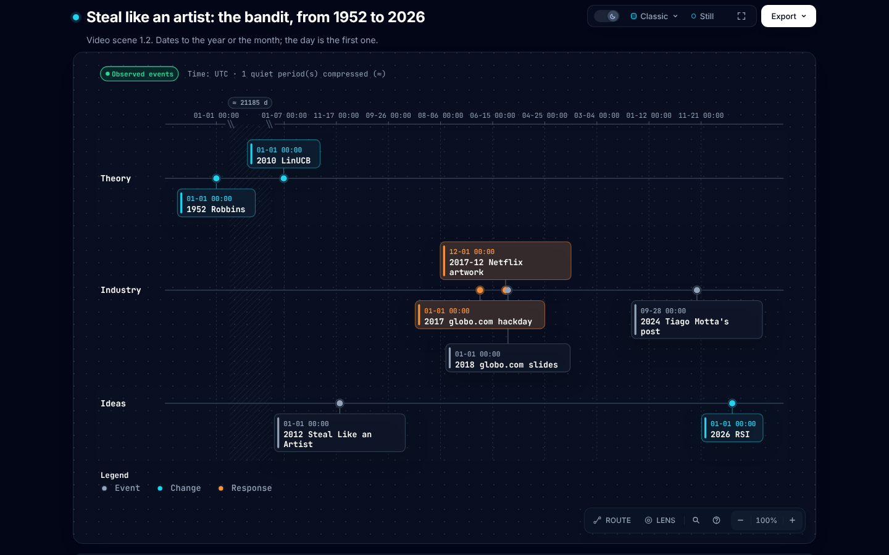
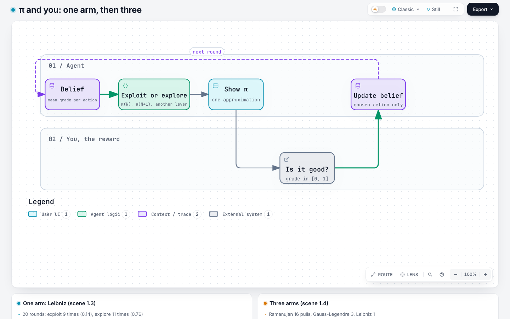
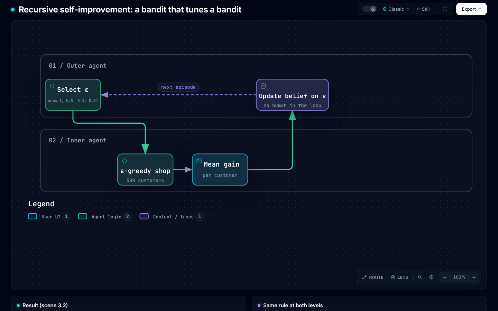

# Multi-armed contextual bandits

Writing standard: ASD-STE100 (Simplified Technical English). Portuguese version: [MULTI_ARMED_CONTEXTUAL_BANDIT.pt-BR.md](MULTI_ARMED_CONTEXTUAL_BANDIT.pt-BR.md). Script of the 30-minute video, in Portuguese: [papers/contextual-bandits/script/](papers/contextual-bandits/script/README.md).

Estimated reading time: ~19 min (3726 words, 67 links, 0 code blocks)

This note follows the order of the video script. The video has three blocks of 10 minutes: **CMAB**, **A/B test** and **RSI**. Each section of this note gives the number of its scene in the script, for example "scene 1.3". The numbers in this note come from [`results.md`](papers/contextual-bandits/script/results.md), which `cabal run video` writes.

## 0. Map for the video edit

Each figure below is an archify diagram. Use the PNG as a reference when you edit the video. Use the HTML file, the interactive diagram, to record the screen or to export an SVG. The source of the figures, in the two languages, is [`docs/diagrams/src/build_candidates.py`](docs/diagrams/src/build_candidates.py). `just diagrams` and `just images` make the files again.

| Scene | Time | archify figure (reference) | Desmos | Code |
|---|---|---|---|---|
| 1.1 Hook | 0:00 to 1:00 | [bandit-round](docs/diagrams/img/en/bandit-round.png) ([html](docs/diagrams/en/bandit-round.html)) | — | `beliefs` in `haskell/app/Video.hs` |
| 1.2 Steal like an artist | 1:00 to 3:00 | [bandit-timeline](docs/diagrams/img/en/bandit-timeline.png) ([html](docs/diagrams/en/bandit-timeline.html)) | — | `animation/timeline.py` (not made yet) |
| 1.3 π and you, one arm | 3:00 to 5:00 | [pi-arms](docs/diagrams/img/en/pi-arms.png) ([html](docs/diagrams/en/pi-arms.html)) | [`1-3-pi.txt`](papers/contextual-bandits/script/desmos/1-3-pi.txt) | `singleArmed`; `step` in `z3-scala/src/main/scala/Video.scala` |
| 1.4 The name, letter by letter | 5:00 to 6:30 | [pi-arms](docs/diagrams/img/en/pi-arms.png) ([html](docs/diagrams/en/pi-arms.html)) | [`1-3-pi.txt`](papers/contextual-bandits/script/desmos/1-3-pi.txt) | `multiArmed`; `haskell/src/Pi.hs` |
| 1.5 Model and rule | 6:30 to 7:30 | [bandit-architecture](docs/diagrams/img/en/bandit-architecture.png) ([html](docs/diagrams/en/bandit-architecture.html)) | [`1-5-width.txt`](papers/contextual-bandits/script/desmos/1-5-width.txt) | `policy_factors` in `z3-scala/src/main/scala/Theorems.scala` |
| 1.6 Explore and exploit | 7:30 to 8:30 | — | [`1-6-ucb.txt`](papers/contextual-bandits/script/desmos/1-6-ucb.txt) | `greedy`, `epsGreedy`, `ucb`; `ucb_zero` |
| 1.7 Netflix | 8:30 to 10:00 | [bandit-architecture](docs/diagrams/img/en/bandit-architecture.png) ([html](docs/diagrams/en/bandit-architecture.html)) | — | `bayesLinear` in `haskell/src/Models.hs` |
| 2.1 What an A/B test is | 10:00 to 11:30 | [ab-test-vs-bandit](docs/diagrams/img/en/ab-test-vs-bandit.png) ([html](docs/diagrams/en/ab-test-vs-bandit.html)) | [`2-1-ab.txt`](papers/contextual-bandits/script/desmos/2-1-ab.txt) | `uniform`; `etc_before` |
| 2.2 The A/B test is a bandit rule | 11:30 to 13:00 | [ab-test-vs-bandit](docs/diagrams/img/en/ab-test-vs-bandit.png) ([html](docs/diagrams/en/ab-test-vs-bandit.html)) | [`2-2-epsilon.txt`](papers/contextual-bandits/script/desmos/2-2-epsilon.txt) | `epsGreedy_one_is_ab_test`, `etc_after` |
| 2.3 The cost of the wait | 13:00 to 15:00 | — | [`2-3-regret.txt`](papers/contextual-bandits/script/desmos/2-3-regret.txt) | `abVsBandit` |
| 2.4 Context makes the test personal | 15:00 to 16:30 | [ab-test-vs-bandit](docs/diagrams/img/en/ab-test-vs-bandit.png) ([html](docs/diagrams/en/ab-test-vs-bandit.html)) | — | `abVsBandit`, "A/B without context" |
| 2.5 What the A/B test does better | 16:30 to 18:00 | [bandit-round](docs/diagrams/img/en/bandit-round.png) ([html](docs/diagrams/en/bandit-round.html)) | [`2-5-propensity.txt`](papers/contextual-bandits/script/desmos/2-5-propensity.txt) | `policy` |
| 2.6 Summary of the block | 18:00 to 20:00 | [bandit-architecture](docs/diagrams/img/en/bandit-architecture.png) ([html](docs/diagrams/en/bandit-architecture.html)) | — | `z3-scala/src/main/scala/Theorems.scala` |
| 3.1 Three words | 20:00 to 21:30 | [rsi-loop](docs/diagrams/img/en/rsi-loop.png) ([html](docs/diagrams/en/rsi-loop.html)) | — | `outer`, `innerEps` in `z3-scala/src/main/scala/Video.scala` |
| 3.2 The smallest recursive loop | 21:30 to 24:00 | [rsi-loop](docs/diagrams/img/en/rsi-loop.png) ([html](docs/diagrams/en/rsi-loop.html)) | — | `rsiLoop` |
| 3.3 The bandit in real RSI | 24:00 to 26:30 | [rsi-loop](docs/diagrams/img/en/rsi-loop.png) ([html](docs/diagrams/en/rsi-loop.html)) | — | `rsiLoop` |
| 3.4 Current belief against new belief | 26:30 to 28:00 | [bandit-round](docs/diagrams/img/en/bandit-round.png) ([html](docs/diagrams/en/bandit-round.html)) | [`3-4-beta.txt`](papers/contextual-bandits/script/desmos/3-4-beta.txt) | `beliefs`; `betaBernoulli` |
| 3.5 What is not a bandit | 28:00 to 29:00 | [bandit-architecture](docs/diagrams/img/en/bandit-architecture.png) ([html](docs/diagrams/en/bandit-architecture.html)) | — | `calibrated`, `ucb_gap` |
| 3.6 Close and credits | 29:00 to 30:00 | — | — | `PROMPTS.md` |

The figures are references for the edit. The final style of the video is the style in the script: Manim, a dark background, blue for the belief, yellow for the selection, red for the regret. archify does not make this style. It gives the structure that the animation follows.

## Block 1. CMAB (0:00 to 10:00)

### 1.1 The problem (scene 1.1)

A system must select one option for each request. Each option is an **arm**.
The system knows some data about the request. This data is the **context**.
After the selection, the system gets a **reward**. A click or a play is a reward.
The system does not see the reward of the arms that it did not select.

The system repeats this loop many times:

1. Get the context `c`.
2. Select an arm `a`.
3. Get the reward `r` for `a` only.
4. Update the model with `(c, a, r)`.

The rule that selects the arm is the **policy**.
The objective is to get the maximum total reward.

The hook of the video shows step 4. The agent has a current belief: option 0 is good in 67 % of the rounds, option 1 in 50 %. Then 4 positive signals for option 1 and 2 negative signals for option 0 come in. The new belief is 0.57 and 0.62, and the selection changes to option 1. The agent changes because of evidence, not because of a guess.

| Term | Meaning | Example (Netflix artwork) |
|---|---|---|
| Context | Data that is known before the selection | Viewing history, country |
| Arm | One option | One image for a title |
| Reward | Result of the selected arm | The member plays the title |
| Policy | Rule from context to arm | Image selection model |
| Regret | Reward of the best arm minus reward of the selected arm, added for all rounds | Plays that the system did not get |

*Figure 1. One round: decide, act, learn. Made with archify. Reference for scenes 1.1, 2.5 and 3.4. Click the figure to open the interactive diagram.*

### 1.2 Where the idea comes from (scene 1.2)

Scene 1.2 is a timeline. The script calls it *steal like an artist*, after the 2012 book by Austin Kleon. The events are:

| Year | Event |
|---|---|
| 1952 | Herbert Robbins states the multi-armed bandit problem. |
| 2010 | Li, Chu, Langford and Schapire publish LinUCB. The context is a vector [6]. |
| 2012 | Austin Kleon publishes *Steal Like an Artist*. |
| 2017 | globo.com makes a bandit service at a hackday, in Scala [9]. |
| 2017-12 | Netflix publishes "Artwork Personalization at Netflix" [1][2]. |
| 2018 | Renan Moreira de Oliveira, of globo.com, shows the slide "MAB ML PARA AB RL" [10]. |
| 2024 | Tiago Motta writes that the globo.com service is still in use [9]. |
| 2026 | The bandit is in the self-improvement loop of agents (block 3). |

The script checked the sources for 1952, 2012, globo.com and 2026. The record of these checks is [`REFERENCES.md`](papers/contextual-bandits/script/REFERENCES.md). This note did not open these sources again; it uses the record of the script. The friend of 2018 in scene 1.2 is not in the figure, because the script still marks the name and the month as `[a confirmar]`.

*Figure 2. The timeline of scene 1.2. Made with archify. The dates are correct to the year or the month; archify shows day 1.*

### 1.3 π and you: one arm, then three (scenes 1.3 and 1.4)

The simple example in the video is the calculation of π. You are the reward.

With one arm, the arm is the Leibniz series. In each round, the agent does one of two things:

- **Exploit**: the agent shows the approximation π(N) again.
- **Explore**: the agent calculates one more term and shows π(N+1).

You give a grade from 0 to 1 for the distance to π. The agent does not read the formula. It only knows your grade. In 20 rounds, with ε = 0.2, the agent exploited 9 times, with a mean grade of 0.14, and explored 11 times, with a mean grade of 0.76. The agent stopped at π(12).

With three arms, two more levers come in: Gauss-Legendre, which doubles the digits at each step (3, 8, 19, 41), and Ramanujan, which gets 7 digits with 1 term and 48 digits with 6 terms. In 20 rounds, the agent pulled Ramanujan 16 times, Gauss-Legendre 3 times and Leibniz 1 time. Gauss-Legendre and Ramanujan have the same grade, 1.00. The greedy rule keeps the first maximum, thus the agent stays on Ramanujan.

The π example has no context. Thus the π example is a MAB, not a CMAB.

*Figure 3. The π loop: the agent selects, shows, and your grade updates the belief. Made with archify. Reference for scenes 1.3 and 1.4.*

### 1.4 The name, letter by letter (scene 1.4)

- **B**, for bandit: a slot machine is a "one-armed bandit".
- **M** and **A**, for multi-armed: many levers, each with an unknown mean prize.
- **C**, for contextual: before the pull, the agent sees one data item about the round, for example morning or night.

Without context, there is only one best lever. With context, the best lever changes in each round, and the policy learns a function from the context to the lever. In LinUCB, this function is linear [6]. In the ice-cream shop of the video, the function is a table with two rows: morning and night.

### 1.5 Model and rule, separate (scene 1.5)

The repository divides the agent into two layers:

- The **reward model** keeps a belief. For each arm, it gives a mean and an uncertainty width.
- The **decision rule** sees only these estimates. It never sees the history or the context.

The Z3 statement `policy_factors` proves this boundary: two histories with the same belief give the same decision. The model in the video is tabular: the mean is the sum divided by the count, and the width is `1/(n+1)`.

*Figure 4. The model layer, the decision layer and the Z3 spec. Made with archify. Reference for scenes 1.5, 1.7, 2.6 and 3.5.*

### 1.6 Explore and exploit (scene 1.6)

The system must do two things at the same time:

- **Exploit**: select the arm that has the highest estimated reward.
- **Explore**: select other arms to get more data about them.

If the system only exploits, it can stay on a bad arm. The estimate for a good arm can be too low after few observations. Then the system never selects that arm again.
If the system only explores, it loses reward on bad arms.

Each rule in this repository makes this balance in a different way:

| Rule | How it explores | Code |
|---|---|---|
| Greedy | It does not explore | `greedy` |
| ε-greedy | It selects a random arm with probability ε | `epsGreedy ε` |
| UCB / LinUCB | It adds an uncertainty bonus, β times the width, to the estimate | `ucb β` |
| Thompson sampling | It samples a mean from the posterior and selects the best sample | `thompsonArm` |

With β = 0, UCB is greedy. The Z3 statement `ucb_zero` proves this.

### 1.7 The complex example: Netflix (scene 1.7)

#### Artwork personalization

Netflix selects the image that it shows for each title, for each member. The Netflix Tech Blog post "Artwork Personalization at Netflix" (December 2017) describes this system. The authors are Ashok Chandrashekar, Fernando Amat, Justin Basilico and Tony Jebara [1][2].

In a 2018 keynote, Tony Jebara gave these data about the system [3]:

- The context is the viewing history and the country of the member.
- The arm is the image. The reward is a play.
- The system uses online learning and contextual bandits.
- The system receives about 20 million image requests per second, at peak.
- The team uses replay to evaluate a new policy offline.

The video compares Netflix with π. In the π example, you are the reward and you know it. At Netflix, you are the reward and you do not know it. The scale makes it necessary for the model to generalize. The repository has the model `bayesLinear`: its mean is a dot product of the context and the weights of the arm.

#### Is it still in use?

The primary sources that this note confirms are from 2017 and 2018. This note did not find a primary Netflix source that confirms the current status (2026). The Netflix Tech Blog has a "contextual-bandit" tag, but this note did not read the posts in it. Do not state that Netflix uses bandits today without a newer source.

## Block 2. A/B test (10:00 to 20:00)

### 2.1 What an A/B test is (scene 2.1)

An A/B/n test has `K` variants. It sends each user to one variant at random, with equal probability. After the test, the team selects the best variant and sends all users to it. The procedure has two phases: split, then decide. The name of this procedure is "explore-then-commit".

The A/B test has three good properties: it is simple to set up, simple to read and simple to defend.

### 2.2 The A/B test is a bandit rule (scene 2.2)

1. **The test period is ε-greedy with ε = 1.** Each arm gets probability `1/K`. This is uniform random allocation. The Z3 statement `epsGreedy_one_is_ab_test` (`z3-scala/src/main/scala/Theorems.scala`) proves this.
2. **The decision phase is ε-greedy with ε = 0**, which is greedy. The statement `epsGreedy_zero` proves this.
3. **The full A/B test is an ε that changes from 1 to 0 on a fixed day.** The invariant R3 (`etc` in `z3-scala/src/main/scala/Video.scala`) proves the two phases: `etc_before` and `etc_after`.

With this view, the question "A/B or bandit?" becomes a different question: how must ε decrease over time?

*Figure 5. The A/B test and the bandit loop. Made with archify. Reference for scenes 2.1, 2.2 and 2.4.*

### 2.3 The cost of the wait (scene 2.3)

The video simulates an ice-cream shop: three flavours, two contexts (morning and night), 5,000 customers, the mean of 20 seeds. The A/B test uses half of the customers for the split phase.

| Policy | Regret |
|---|---|
| A/B test (T/2, then commit) | 128.8 |
| A/B test without context | 178.9 |
| ε-greedy, ε = 0.1 | 76.4 |
| UCB, β = 2 | 19.5 |

The bandit changes the allocation during the test. It sends more traffic to arms that look better. Thus the regret during the test is less. Jebara calls the loop "collect data for months, train, then test" "a massive amount of regret" [3].

### 2.4 Context makes the test personal (scene 2.4)

An A/B test finds one best variant for all users. A contextual bandit finds the best variant for each context. In the ice-cream shop, the A/B test without context has a regret of 178.9. The A/B test that separates morning and night has 128.8. One A/B test for each user segment is a special case of a contextual bandit.

### 2.5 What the A/B test still does better (scene 2.5)

A fixed random allocation gives a simple, unbiased estimate of the effect. A bandit changes the allocation, so a simple mean of the logs is biased. To evaluate a bandit offline, record the probability of each selection. Then use replay or inverse propensity weighting (IPW). The function `policy` gives the full distribution. This distribution is the propensity that the log must record.

Netflix still used an A/B test to approve the artwork system before the rollout [3]. Thus the bandit did not replace the A/B test. It replaced the slow loop inside it.

### 2.6 Summary of the block (scene 2.6)

An A/B test is one specific policy in the bandit model: no context, a fixed uniform allocation, and one decision at the end. A contextual bandit removes these three limits.

Two teams use a bandit in production, from the sources:

- **Netflix, homepage billboard**: the large banner at the top of the homepage recommends one title. A 2018 talk by Jaya Kawale and Elliot Chow describes a bandit framework with ε-greedy [4][5]. The exploration selects a title uniformly at random and gives unbiased data for training. The team evaluated the policies offline with replay and online with A/B tests. The reason: the catalog, the popularity of titles and the interests of members change, and batch models adapt too slowly.
- **globo.com**: the bandit service selects a photo and the best position for an advertisement. Tiago Motta writes this in Portuguese [9].

The rule of thumb in the video: use an A/B test when there is one decision that you must defend. Use a bandit when the decision occurs thousands of times each day and each error costs little. Use the two when you can: the bandit inside, the A/B test outside.

Z3 proves five facts for up to five arms and all real values of the estimates: each rule gives a valid distribution; ε-greedy gives each arm at least ε/K; greedy and UCB select a maximum; ε-greedy with ε = 1 is the A/B test; and, with a calibrated model, the UCB arm loses at most 2β times the width (`ucb_gap`). The probabilistic regret bound is still open.

## Block 3. RSI, recursive self-improvement (20:00 to 30:00)

### 3.1 Three words (scene 3.1)

| Word | What the agent does | What the word needs |
|---|---|---|
| Improvement | The agent selects better today than yesterday | A metric |
| Self-improvement | The agent makes the change itself | A closed loop, with no person in it |
| Recursive self-improvement | The change is in the mechanism that makes the changes | Access of the loop to the loop itself |

Anthropic defines RSI, in the essay "When AI builds itself", as a system that "could fully autonomously design and develop its successor" [11].

### 3.2 The smallest recursive loop (scene 3.2)

The inner agent is the ε-greedy rule of the ice-cream shop. The outer agent is a second bandit. Its arms are values of ε: 1, 0.5, 0.1, 0.01. In each episode, the outer agent selects an ε, the inner agent serves 500 customers with this ε, and the mean gain goes back to the outer agent as its reward.

| ε of the inner agent | Episodes selected (of 200) | Mean gain per customer |
|---|---|---|
| 1.0 | 11 | 0.080 |
| 0.5 | 168 | 0.099 |
| 0.1 | 12 | 0.085 |
| 0.01 | 9 | 0.057 |

The outer agent learns how the inner agent must learn. The same `epsGreedy` works at the two levels. The invariant R4 in Z3 proves this: `rsi_valid` and `outer_explores`. ε = 0.5 wins because the horizon is short, 500 customers for each episode, and the model starts from zero.

*Figure 6. The outer loop selects the ε of the inner loop. Made with archify. Reference for scenes 3.1, 3.2 and 3.3.*

### 3.3 The bandit in real RSI (scene 3.3)

In real systems, the arms of the outer loop are changes to the agent itself. The SIA paper, from 2026, describes a "Feedback-Agent" that selects between edits to the scaffold, the prompts and the tools, and updates to the weights of the model [12]. A deterministic evaluator gives the reward. This is the structure of a bandit: a selection between arms, with a reward that the system sees only for the selected arm. The script read SIA through a review, not through the PDF.

Anthropic reports that the speed-up of a training code went from about 3 times, in May 2025, to about 52 times, in April 2026 [11]. Anthropic also reports an automatic code review that would have found about one third of the errors behind past incidents [11]. The other two thirds show that the reward measures only a part of what is important.

### 3.4 Current belief against new belief (scene 3.4)

The Beta-Bernoulli model keeps two counts for each option: successes and failures. Each signal from the user adds 1 to one of the counts. The current belief was 0.67 and 0.50. After 4 signals for option 1 and 2 signals against option 0, the new belief is 0.57 and 0.62, and the selection changes (scene 1.1). The new belief adds the new signals to the old ones; it does not erase the old belief. The width decreases for the two arms.

### 3.5 What is not a bandit (scene 3.5)

- A bandit sees the reward of one round and does not plan the next round. When the selection of today changes the state of tomorrow, the problem is full reinforcement learning.
- If it is easy to deceive the reward, the loop learns to deceive the reward. The lemma `ucb_gap` needs the premise `calibrated`: without calibrated uncertainty, the optimism of UCB has no guarantee. The script does not cite a specific work on reward hacking.

## 4. Connection to this repository

| Concept in this note | Z3 | Haskell |
|---|---|---|
| Probabilistic model | `update`, `estimate`, `posterior` (`Examples.scala`) | `RewardModel`, `Models.hs` |
| Policy | `policy` | `policy`, `act` |
| A/B/n allocation | `epsGreedy(1, est)` = `uniform(K)` | `epsGreedy 1` |
| Full A/B test | `etc`, `etc_before`, `etc_after` (`Video.scala`) | `etc` (`Video.hs`) |
| Exploration guarantee | `epsGreedy_explores` | — |
| UCB regret, one round | `ucb_gap` | `ucb` |
| Model gives the only path from history to decision | `policy_factors` | `posterior` |
| π as a bandit | `step`, `leibnizPair_pos`, `ramTerm_pos` (`Video.scala`) | `Pi.hs`, `singleArmed`, `multiArmed` |
| RSI | `outer`, `innerEps`, `rsi_valid` (`Video.scala`) | `outer`, `inner`, `rsiLoop` |

## 5. Sources

1. Netflix Tech Blog, "Artwork Personalization at Netflix", 2017-12. <https://netflixtechblog.com/artwork-personalization-c589f074ad76> (this note read a summary of it, not the full text)
2. Dezeen, "Netflix targets different film artworks to suit users' viewing habits", 2017-12-20. <https://www.dezeen.com/2017/12/20/netflix-targets-film-artwork-depending-users-viewing-habits-design-technology/>
3. Tony Jebara, "Artwork Personalization at Netflix", keynote, 2018. <https://www.aicouncil.com/talks/artwork-personalization-at-netflix>
4. Jaya Kawale and Elliot Chow, "A Multi-Armed Bandit Framework for Recommendations at Netflix", 2018. <https://aicouncil.com/a-multi-armed-bandit-framework-for-recommendations-at-netflix>
5. Slides of [4]. <https://www.slideshare.net/slideshow/a-multiarmed-bandit-framework-for-recommendations-at-netflix/102629078>
6. Li, Chu, Langford, Schapire, "A Contextual-Bandit Approach to Personalized News Article Recommendation" (LinUCB), 2010. <https://arxiv.org/abs/1003.0146>
7. Lattimore and Szepesvári, *Bandit Algorithms*, Cambridge University Press, 2020.
8. The video script and the record of its sources: [`papers/contextual-bandits/script/`](papers/contextual-bandits/script/README.md), [`refs.bib`](papers/contextual-bandits/script/refs.bib), [`REFERENCES.md`](papers/contextual-bandits/script/REFERENCES.md).
9. Tiago Motta, post about the bandit service of globo.com, 2024-09-28. Key `motta2024bandit` in [8].
10. Renan Moreira de Oliveira, "Machine Learning na globo.com", slides, 2018. Key `oliveira2018globo` in [8].
11. Anthropic, "When AI builds itself", 2026. Key `anthropic2026builds` in [8].
12. A review of the SIA paper (arXiv 2605.27276), 2026. Key `bhavsar2026sia` in [8]; status `partial`.
