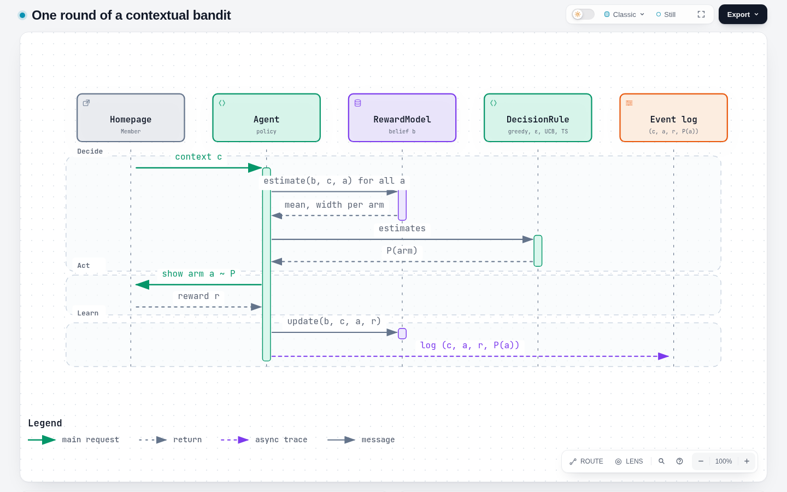
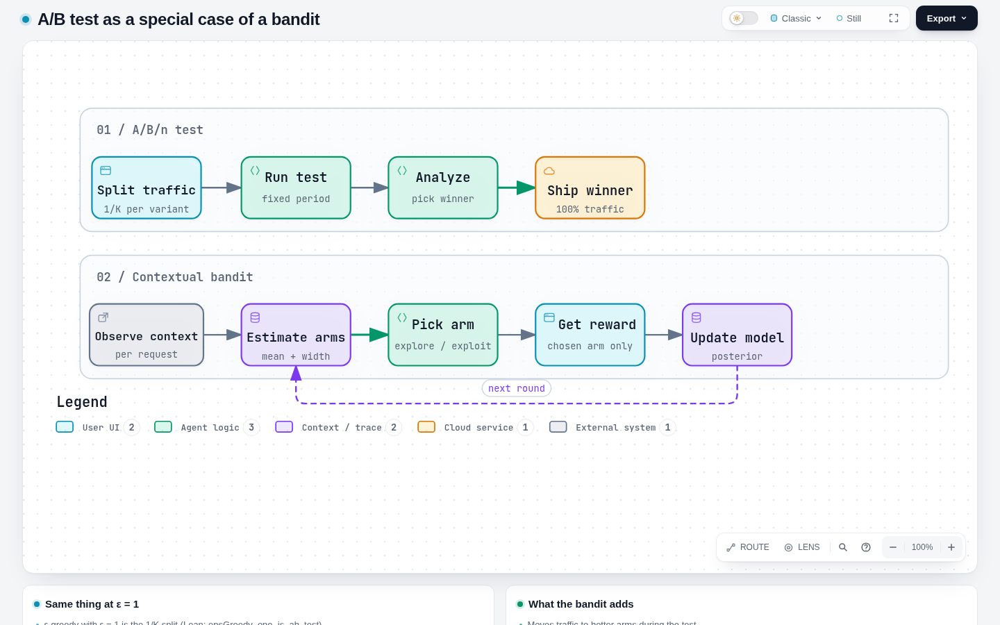
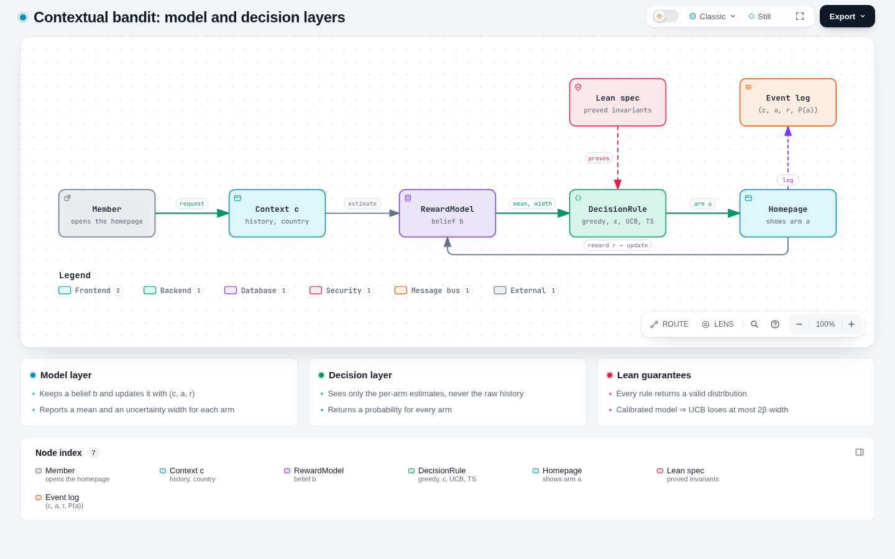

# Multi-armed contextual bandits

Writing standard: ASD-STE100 (Simplified Technical English). Portuguese version: [MULTI_ARMED_CONTEXTUAL_BANDIT.pt-BR.md](MULTI_ARMED_CONTEXTUAL_BANDIT.pt-BR.md). Script of the 30-minute video, in Portuguese: [papers/contextual-bandits/roteiro/](papers/contextual-bandits/roteiro/README.md).

Estimated reading time: ~6 min (1133 words, 7 links, 0 code blocks)

## 1. The problem

A system must select one option for each request. Each option is an **arm**.
The system knows some data about the request. This data is the **context**.
After the selection, the system gets a **reward**. A click or a play is a reward.
The system does not see the reward of the arms that it did not select.

The system repeats this loop many times:

1. Get the context `c`.
2. Select an arm `a`.
3. Get the reward `r` for `a` only.
4. Update the model with `(c, a, r)`.

The rule that selects the arm is the **policy**.
The objective is to get the maximum total reward.

| Term | Meaning | Example (Netflix artwork) |
|---|---|---|
| Context | Data that is known before the selection | Viewing history, country |
| Arm | One option | One image for a title |
| Reward | Result of the selected arm | The member plays the title |
| Policy | Rule from context to arm | Image selection model |
| Regret | Reward of the best arm minus reward of the selected arm, added for all rounds | Plays that the system did not get |

*Figure 1. One round: decide, act, learn. Made with archify. Click the figure to open the interactive diagram.*

## 2. Exploration and exploitation

The system must do two things at the same time:

- **Exploit**: select the arm that has the highest estimated reward.
- **Explore**: select other arms to get more data about them.

If the system only exploits, it can stay on a bad arm. The estimate for a good arm can be too low after few observations. Then the system never selects that arm again.
If the system only explores, it loses reward on bad arms.

Each rule in this repository makes this balance in a different way:

| Rule | How it explores | Code |
|---|---|---|
| Greedy | It does not explore | `greedy` |
| ε-greedy | It selects a random arm with probability ε | `epsGreedy ε` |
| UCB / LinUCB | It adds an uncertainty bonus to the estimate | `ucb β` |
| Thompson sampling | It samples a mean from the posterior and selects the best sample | `thompsonArm` |

## 3. Why the bandit is a general form of the A/B test

An A/B/n test has `K` variants. It sends each user to one variant at random, with equal probability. After the test, the team selects the best variant and sends all users to it.

Compare this procedure with the bandit rules:

1. **The test period is ε-greedy with ε = 1.** Each arm gets probability `1/K`. This is uniform random allocation. The Lean theorem `epsGreedy_one_is_ab_test` proves this statement.
2. **The full A/B procedure is "explore-then-commit".** The system explores for a fixed number of rounds. Then it exploits the best arm for all rounds that follow.
3. **The bandit changes the allocation during the test.** It sends more traffic to arms that look better. Thus the regret during the test is less.
4. **The context makes the test personal.** An A/B test finds one best variant for all users. A contextual bandit finds the best variant for each context. One A/B test for each user segment is a special case.

Thus an A/B test is one specific policy in the bandit model: no context, a fixed uniform allocation, and one decision at the end.

The A/B test still has an advantage. A fixed random allocation gives a simple, unbiased estimate of the effect. A bandit changes the allocation, so a simple mean of the logs is biased. To evaluate a bandit offline, record the probability of each selection. Then use replay or inverse propensity weighting. Netflix uses replay for this purpose (see section 4).

*Figure 2. The A/B test and the bandit loop. Made with archify.*

## 4. Netflix

### 4.1 Artwork personalization

Netflix selects the image that it shows for each title, for each member. The Netflix Tech Blog post "Artwork Personalization at Netflix" (December 2017) describes this system. The authors are Ashok Chandrashekar, Fernando Amat, Justin Basilico and Tony Jebara [1][2].

In a 2018 keynote, Tony Jebara gave these data about the system [3]:

- The context is the viewing history and the country of the member.
- The arm is the image. The reward is a play.
- The system uses online learning and contextual bandits.
- The system receives more than 20 million image requests per second.
- The team uses replay to evaluate a new policy offline.

Why Netflix used a bandit and not only A/B tests, from the same keynote [3]:

- The usual procedure is: collect data for months, train a model, then do an A/B test. Members get the weaker experience during all of this time. Jebara calls this "a massive amount of regret".
- A bandit learns, acts and collects data in one loop. Members get the improvement sooner.
- Netflix still used an A/B test to approve the full system before the rollout. Thus the bandit did not replace the A/B test. It replaced the slow loop inside it.

### 4.2 Homepage billboard

The billboard is the large banner at the top of the Netflix homepage. It recommends one title. A 2018 talk by Jaya Kawale and Elliot Chow describes a bandit framework for this recommendation [4][5]:

- The framework uses ε-greedy. The exploration part selects a title uniformly at random. The talk says that this gives unbiased data for training.
- The exploit part uses one model for each title. It predicts the probability of a play. It selects the title with the highest probability.
- A second policy uses incrementality. It estimates the causal effect of the recommendation, not only the probability of a play.
- The team evaluated the policies offline with replay and online with A/B tests.
- The reasons for a bandit: the catalog changes, the popularity of titles changes, and the interests of members change. Batch models adapt too slowly to these changes.

### 4.3 Is it still in use?

The primary sources that this note confirms are from 2017 and 2018. This note did not find a primary Netflix source that confirms the current status (2026). The Netflix Tech Blog has a "contextual-bandit" tag, but this note did not read the posts in it. Do not state that Netflix uses bandits today without a newer source.

## 5. Connection to this repository

| Concept in this note | Lean | Haskell |
|---|---|---|
| Probabilistic model | `RewardModel` | `RewardModel`, `Models.hs` |
| Policy | `policy` | `policy`, `act` |
| A/B/n allocation | `epsGreedy 1` = `uniform K` | `epsGreedy 1` |
| Exploration guarantee | `epsGreedy_explores` | — |
| UCB regret, one round | `ucb_gap` | `ucb` |
| Model gives the only path from history to decision | `policy_factors` | `posterior` |

*Figure 3. The model layer, the decision layer and the Lean spec. Made with archify.*

## 6. Sources

1. Netflix Tech Blog, "Artwork Personalization at Netflix", 2017-12. <https://netflixtechblog.com/artwork-personalization-c589f074ad76> (this note read a summary of it, not the full text)
2. Dezeen, "Netflix targets different film artworks to suit users' viewing habits", 2017-12-20. <https://www.dezeen.com/2017/12/20/netflix-targets-film-artwork-depending-users-viewing-habits-design-technology/>
3. Tony Jebara, "Artwork Personalization at Netflix", keynote, 2018. <https://www.aicouncil.com/talks/artwork-personalization-at-netflix>
4. Jaya Kawale and Elliot Chow, "A Multi-Armed Bandit Framework for Recommendations at Netflix", 2018. <https://aicouncil.com/a-multi-armed-bandit-framework-for-recommendations-at-netflix>
5. Slides of [4]. <https://www.slideshare.net/slideshow/a-multiarmed-bandit-framework-for-recommendations-at-netflix/102629078>
6. Li, Chu, Langford, Schapire, "A Contextual-Bandit Approach to Personalized News Article Recommendation" (LinUCB), 2010. <https://arxiv.org/abs/1003.0146>
7. Lattimore and Szepesvári, *Bandit Algorithms*, Cambridge University Press, 2020.
