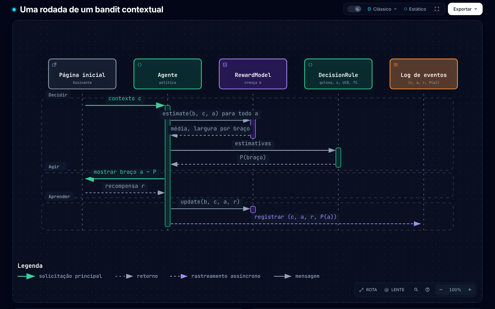
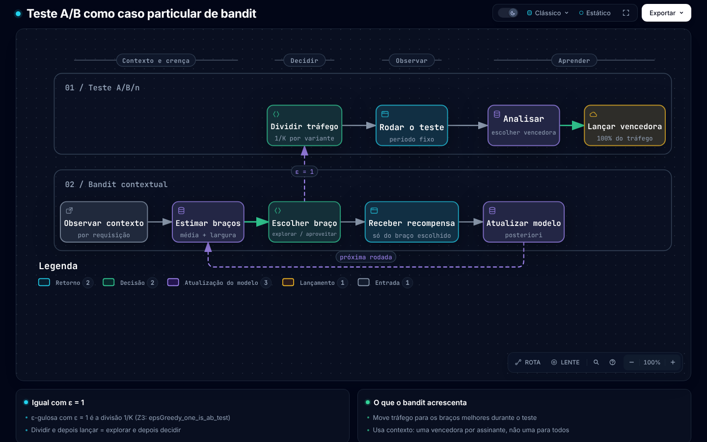
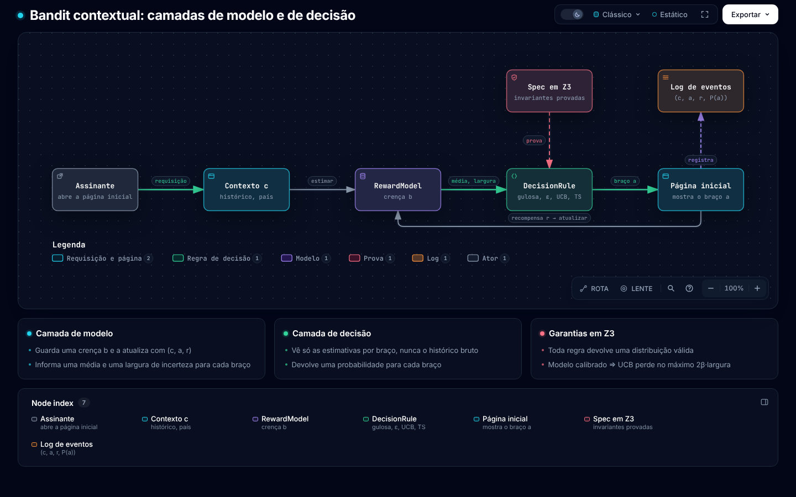

# Bandits contextuais de múltiplos braços

Padrão de escrita: gramatico, nível `smart-note + descritivo`. Versão em inglês: [MULTI_ARMED_CONTEXTUAL_BANDIT.md](MULTI_ARMED_CONTEXTUAL_BANDIT.md). Nota vizinha: [README.md](README.md). Roteiro do vídeo de 30 minutos: [papers/contextual-bandits/script/](papers/contextual-bandits/script/README.md).

Leitura estimada: ~6 min (1213 palavras, 8 links, 0 blocos de código)

## 1. O problema

O sistema escolhe uma opção para cada requisição. Cada opção é um **braço**.
O sistema conhece alguns dados da requisição. Esses dados são o **contexto**.
Depois da escolha, o sistema recebe uma **recompensa**. Um clique ou uma reprodução é uma recompensa.
O sistema não vê a recompensa dos braços que não escolheu.

O sistema repete este ciclo muitas vezes:

1. O sistema recebe o contexto `c`.
2. O sistema escolhe um braço `a`.
3. O sistema recebe a recompensa `r` só do braço `a`.
4. O sistema atualiza o modelo com `(c, a, r)`.

A regra que escolhe o braço é a **política**.
O objetivo é maximizar a recompensa total.

| Termo | Significado | Exemplo (imagens da Netflix) |
|---|---|---|
| Contexto | Dados conhecidos antes da escolha | Histórico de visualização, país |
| Braço | Uma opção | Uma imagem de um título |
| Recompensa | Resultado do braço escolhido | O assinante reproduz o título |
| Política | Regra que leva do contexto ao braço | Modelo que escolhe a imagem |
| Arrependimento (*regret*) | Soma, em todas as rodadas, da recompensa do melhor braço menos a recompensa do braço escolhido | Reproduções que o sistema perdeu |

*Figura 1. Uma rodada: decidir, agir, aprender. Feita com archify. Clique na figura para abrir o diagrama interativo.*

## 2. Exploração e aproveitamento

O sistema faz duas coisas ao mesmo tempo:

- **Aproveitar**: o sistema escolhe o braço com a maior recompensa estimada.
- **Explorar**: o sistema escolhe outros braços para coletar dados sobre eles.

Um sistema que só aproveita pode ficar preso num braço ruim. Depois de poucas observações, a estimativa de um braço bom pode ficar baixa demais. Nesse caso, o sistema nunca mais escolhe esse braço.
Um sistema que só explora perde recompensa nos braços ruins.

Cada regra deste repositório equilibra os dois lados de um jeito:

| Regra | Como a regra explora | Código |
|---|---|---|
| Gulosa | A regra não explora | `greedy` |
| ε-gulosa | A regra escolhe um braço aleatório com probabilidade ε | `epsGreedy ε` |
| UCB / LinUCB | A regra soma um bônus de incerteza à estimativa | `ucb β` |
| Amostragem de Thompson | A regra sorteia uma média da posteriori e escolhe a maior | `thompsonArm` |

## 3. Por que o bandit generaliza o teste A/B

Um teste A/B/n tem `K` variantes. O teste manda cada usuário para uma variante por sorteio, com probabilidades iguais. No fim do teste, a equipe escolhe a melhor variante e manda todos os usuários para ela.

Compare esse procedimento com as regras de bandit:

1. **O período de teste é a regra ε-gulosa com ε = 1.** Cada braço recebe probabilidade `1/K`. Essa é a alocação aleatória uniforme. A afirmação `epsGreedy_one_is_ab_test` em Z3 (`z3/theorems.py`) prova isso.
2. **O procedimento A/B completo é "explorar e depois decidir"** (*explore-then-commit*). O sistema explora por um número fixo de rodadas. Depois, o sistema aproveita o melhor braço em todas as rodadas seguintes.
3. **O bandit muda a alocação durante o teste.** O bandit manda mais tráfego para os braços que parecem melhores. Por isso, o arrependimento durante o teste é menor.
4. **O contexto personaliza o teste.** Um teste A/B encontra uma única melhor variante para todos os usuários. Um bandit contextual encontra a melhor variante para cada contexto. Um teste A/B por segmento de usuários é um caso particular.

Conclusão: o teste A/B é uma política específica dentro do modelo de bandit. Essa política não usa contexto, usa alocação uniforme fixa e toma uma única decisão no fim.

O teste A/B ainda tem uma vantagem. A alocação aleatória fixa dá uma estimativa simples e sem viés do efeito. O bandit muda a alocação, e por isso a média simples dos registros tem viés. Para avaliar um bandit *offline*, registre a probabilidade de cada escolha. Depois, use *replay* ou ponderação pelo inverso da propensão (IPW). A Netflix usa *replay* para esse fim (ver a seção 4).

*Figura 2. O teste A/B e o ciclo do bandit. Feita com archify.*

## 4. Netflix

### 4.1 Personalização de imagens

A Netflix escolhe, para cada assinante, a imagem que mostra para cada título. O post "Artwork Personalization at Netflix" do Netflix Tech Blog (2017-12) descreve esse sistema. Os autores são Ashok Chandrashekar, Fernando Amat, Justin Basilico e Tony Jebara [1][2].

Numa palestra de abertura de 2018, Tony Jebara deu estes dados sobre o sistema [3]:

- O contexto é o histórico de visualização e o país do assinante.
- O braço é a imagem. A recompensa é uma reprodução.
- O sistema usa aprendizado *online* e bandits contextuais.
- O sistema recebe mais de 20 milhões de requisições de imagem por segundo.
- A equipe usa *replay* para avaliar uma política nova *offline*.

Motivos da Netflix para usar bandit, e não só testes A/B, segundo a mesma palestra [3]:

- O procedimento comum tem três passos. A equipe coleta dados por meses. A equipe treina um modelo. Depois, a equipe faz um teste A/B. Durante todo esse tempo, os assinantes recebem a experiência pior. Jebara chama isso de "a massive amount of regret".
- O bandit aprende, age e coleta dados num único ciclo. Os assinantes recebem a melhoria mais cedo.
- A Netflix ainda usou um teste A/B para aprovar o sistema completo antes da implantação. Portanto, o bandit não substituiu o teste A/B. O bandit substituiu o ciclo lento dentro do teste.

### 4.2 Billboard da página inicial

O *billboard* é o banner grande no topo da página inicial da Netflix. O *billboard* recomenda um único título. Uma palestra de 2018, de Jaya Kawale e Elliot Chow, descreve um *framework* de bandit para essa recomendação [4][5]:

- O *framework* usa a regra ε-gulosa. A parte de exploração sorteia um título com probabilidade uniforme. Segundo a palestra, essa parte dá dados sem viés para o treino.
- A parte de aproveitamento usa um modelo por título. O modelo prevê a probabilidade de reprodução. A parte de aproveitamento escolhe o título com a maior probabilidade.
- Uma segunda política usa incrementalidade. Essa política estima o efeito causal da recomendação, e não só a probabilidade de reprodução.
- A equipe avaliou as políticas *offline* com *replay* e *online* com testes A/B.
- Motivos para usar bandit: o catálogo muda, a popularidade dos títulos muda e o interesse dos assinantes muda. Os modelos em lote se adaptam devagar demais a essas mudanças.

### 4.3 A Netflix ainda usa bandits?

As fontes primárias que esta nota confirmou são de 2017 e 2018. Esta nota não encontrou uma fonte primária da Netflix que confirme o uso atual (2026). O Netflix Tech Blog tem a tag "contextual-bandit", mas esta nota não leu os posts dessa tag. ⚠ Não afirme que a Netflix usa bandits hoje sem uma fonte mais recente.

## 5. Ligação com este repositório

| Conceito desta nota | Z3 | Haskell |
|---|---|---|
| Modelo probabilístico | `update`, `estimate`, `posterior` (`examples.py`) | `RewardModel`, `Models.hs` |
| Política | `policy` | `policy`, `act` |
| Alocação A/B/n | `eps_greedy(1, est)` = `uniform(K)` | `epsGreedy 1` |
| Garantia de exploração | `epsGreedy_explores` | — |
| Arrependimento do UCB numa rodada | `ucb_gap` | `ucb` |
| O modelo é o único caminho do histórico até a decisão | `policy_factors` | `posterior` |

*Figura 3. A camada de modelo, a camada de decisão e a spec em Z3. Feita com archify (a figura ainda diz Lean; o workflow manual `diagrams` a renderiza de novo).*

## 6. Fontes

1. Netflix Tech Blog, "Artwork Personalization at Netflix", 2017-12. <https://netflixtechblog.com/artwork-personalization-c589f074ad76> (esta nota leu um resumo do post, não o texto completo)
2. Dezeen, "Netflix targets different film artworks to suit users' viewing habits", 2017-12-20. <https://www.dezeen.com/2017/12/20/netflix-targets-film-artwork-depending-users-viewing-habits-design-technology/>
3. Tony Jebara, "Artwork Personalization at Netflix", palestra de abertura, 2018. <https://www.aicouncil.com/talks/artwork-personalization-at-netflix>
4. Jaya Kawale e Elliot Chow, "A Multi-Armed Bandit Framework for Recommendations at Netflix", 2018. <https://aicouncil.com/a-multi-armed-bandit-framework-for-recommendations-at-netflix>
5. Slides de [4]. <https://www.slideshare.net/slideshow/a-multiarmed-bandit-framework-for-recommendations-at-netflix/102629078>
6. Li, Chu, Langford e Schapire, "A Contextual-Bandit Approach to Personalized News Article Recommendation" (LinUCB), 2010. <https://arxiv.org/abs/1003.0146>
7. Lattimore e Szepesvári, *Bandit Algorithms*, Cambridge University Press, 2020.
