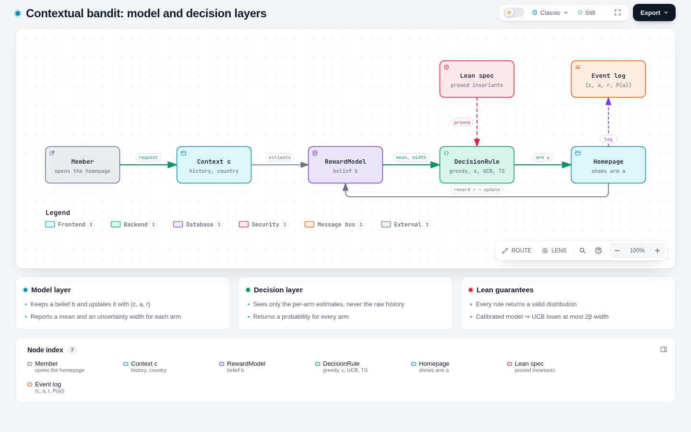
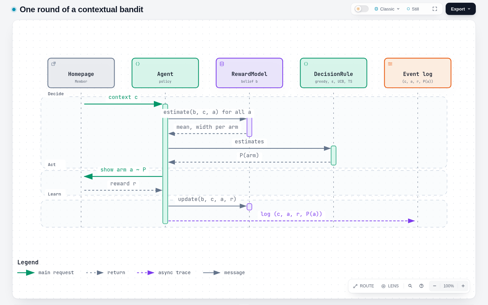
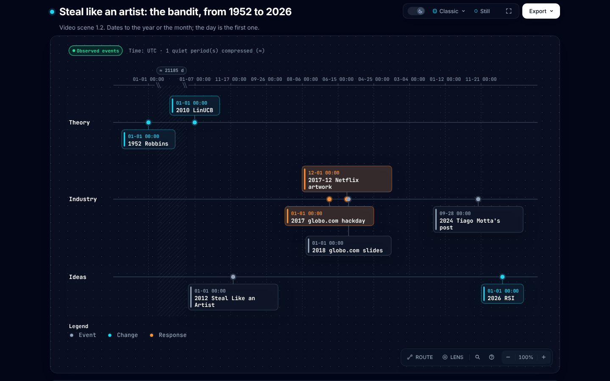
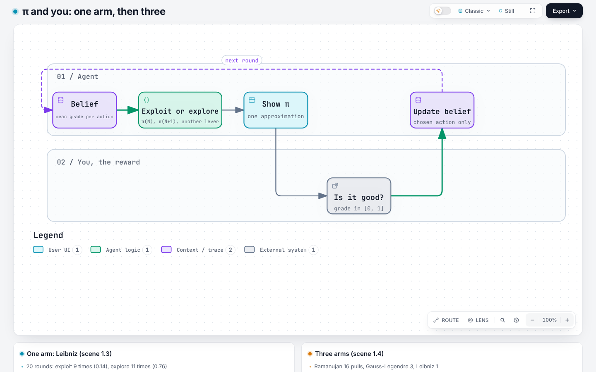
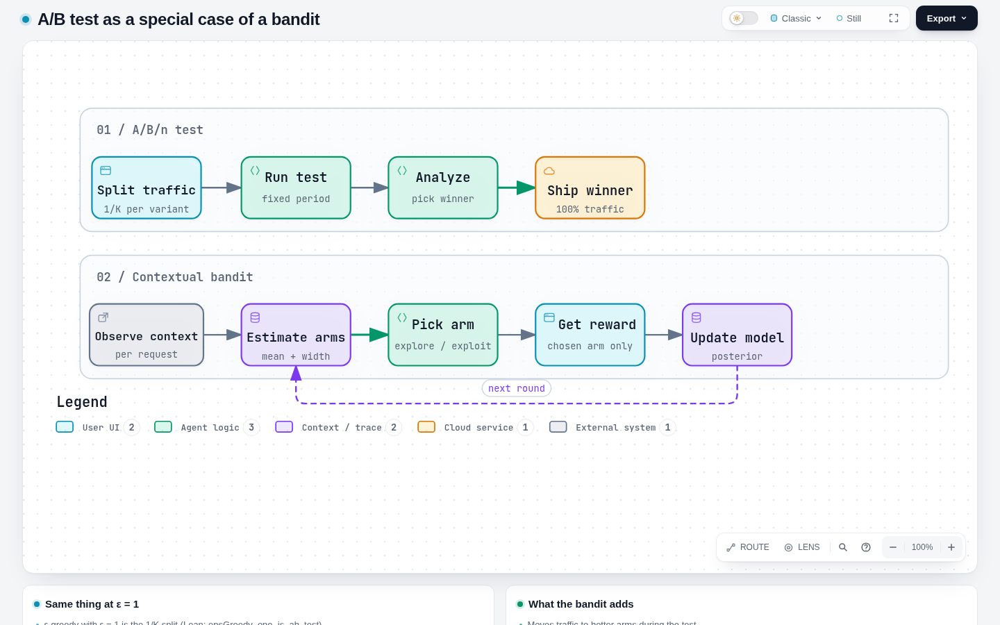
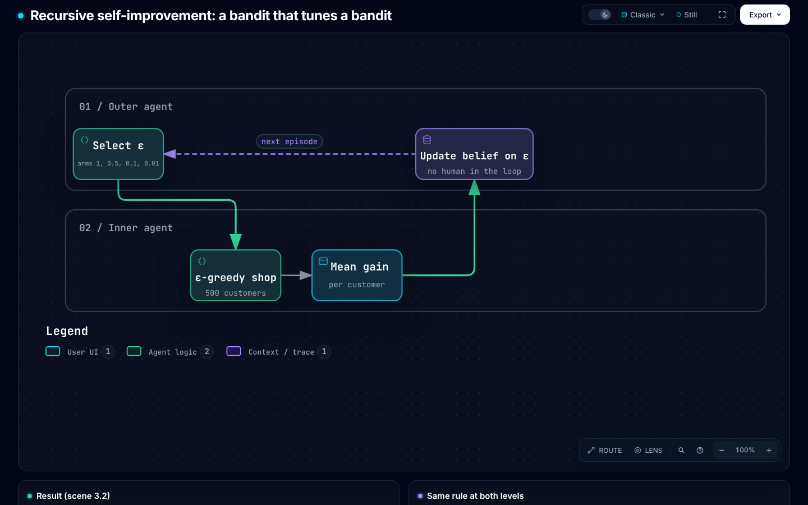

# Contextual bandits

Everything about the contextual bandit in this repository is on this page: the idea, the index of
files, the commands, the interface, what Z3 proves, the Haskell port, and the note for the video.
The Z3 code itself stays in [`z3-scala/`](../z3-scala/README.md). Writing standard: ASD-STE100.
Portuguese edition: [README.pt-BR.md](README.pt-BR.md).

## Contents

1. [The idea](#1-the-idea)
2. [Files](#2-files)
3. [Run](#3-run)
4. [The interface](#4-the-interface)
5. [What Z3 proves](#5-what-z3-proves)
6. [The Haskell port](#6-the-haskell-port)
7. [Caveats](#7-caveats)
8. [Note for the video](#8-note-for-the-video)
   - [Scene map](#scene-map)
   - [Block 1. CMAB](#block-1-cmab)
   - [Block 2. A/B test](#block-2-ab-test)
   - [Block 3. RSI](#block-3-rsi)
9. [Sources](#9-sources)

## 1. The idea

A system selects one option (an **arm**) for each request. It knows some data about the request
(the **context**). It gets a **reward** for the selected arm only. The **policy** is the rule from
context to arm. **Regret** is the reward of the best arm minus the reward of the selected arm,
added for all rounds.

> **The bandit is a decision rule on top of a probabilistic model.**
> The model turns history into beliefs. The decision rule turns beliefs into an action.

```text
           context c
               │
               ▼
 history ─► RewardModel ──estimate(b, c, a) = (mean, width)──► DecisionRule ──► action a
   ▲        (belief b)    sample(b, c, a)  ~ posterior          greedy / ε-greedy /      │
   │                                                            UCB / Thompson           ▼
   └────────────── update(b, (c, a, r)) ◄────────────── reward r ◄──────────────── environment
```

The decision rule sees only the per-arm estimates, never the history or the context. Thus any
model that gives a mean and an uncertainty works with any rule. `policy_factors` proves this
boundary.

| Rule | How it explores | Code |
|---|---|---|
| Greedy | It does not explore | `greedy` |
| ε-greedy | It selects a random arm with probability ε | `epsGreedy ε` |
| UCB / LinUCB | It adds β times the width to the mean | `ucb β` |
| Thompson sampling | It selects the best of one sample from the posterior | `thompsonArm` |

[](../docs/diagrams/en/bandit-architecture.html)

*Figure 1. The model layer, the decision layer and the Z3 spec (archify; click for the interactive
diagram).*

## 2. Files

| Part | Files |
|---|---|
| Z3 specification | [`Bandit.scala`](../z3-scala/src/main/scala/bandit/domain/Bandit.scala) (the two layers, the rules), [`Theorems.scala`](../z3-scala/src/main/scala/bandit/domain/Theorems.scala) (K = 1 to 5), [`Examples.scala`](../z3-scala/src/main/scala/bandit/domain/Examples.scala) (tabular model, exact rationals), [`Video.scala`](../z3-scala/src/main/scala/bandit/domain/Video.scala) (the video's invariants R1 to R5), [`BanditChecks.scala`](../z3-scala/src/main/scala/bandit/application/BanditChecks.scala); how Z3 runs: [`z3-scala/README.md`](../z3-scala/README.md) |
| Why Z3 and not Lean | [`docs/decisions/0001-z3-over-lean.md`](../docs/decisions/0001-z3-over-lean.md) |
| Haskell port | [`haskell/src/ContextualBandit.hs`](../haskell/src/ContextualBandit.hs) (interface, rules, SplitMix RNG), [`Models.hs`](../haskell/src/Models.hs) (Beta-Bernoulli, Bayesian linear, `fromPredictor`), [`Video.hs`](../haskell/src/Video.hs), [`Pi.hs`](../haskell/src/Pi.hs), [`app/Main.hs`](../haskell/app/Main.hs) (spec check and simulations), [`app/Video.hs`](../haskell/app/Video.hs) |
| LiquidHaskell | [`haskell/LIQUIDHASKELL.md`](../haskell/LIQUIDHASKELL.md) (what is proved and trusted), [`checks/liquidhaskell.sh`](../checks/liquidhaskell.sh) |
| Preprint | [`papers/contextual-bandits/`](../papers/contextual-bandits/metadata.md) |
| Video script (pt-BR) | [`papers/contextual-bandits/script/`](../papers/contextual-bandits/script/README.md), its numbers in [`results.md`](../papers/contextual-bandits/script/results.md), its Desmos files in [`desmos/`](../papers/contextual-bandits/script/desmos/README.md) |
| Diagrams | [`docs/diagrams/src/build_candidates.py`](../docs/diagrams/src/build_candidates.py) (source, both languages), [`docs/diagrams/en/`](../docs/diagrams/index.html) (HTML), `docs/diagrams/img/en/` (PNG) |
| Recipes and checks | [`just/contextual-bandits.just`](../just/contextual-bandits.just), [`checks/contextual-bandits.sh`](../checks/contextual-bandits.sh), [`just/liquidhaskell.just`](../just/liquidhaskell.just) |

## 3. Run

```bash
just z3                                  # every Z3 statement (nix develop .#scala); each line OK
cd haskell && cabal run examples         # spec check, then 4 simulations; or: runghc -isrc app/Main.hs
cd haskell && cabal run video            # the video's experiments; writes the script's results.md
just liquid                              # LiquidHaskell; SAFE for each module
just paper contextual-bandits            # the preprint (inside nix develop)
just script                              # the video script, pt-BR
```

The first block of `cabal run examples` is the spec check against `Examples.scala` and
`Video.scala`. Each line must say `OK`.

## 4. The interface

| Concept | Z3 (`Bandit.scala`, `Examples.scala`, `Video.scala`) | Haskell |
|---|---|---|
| Arm | index `0..K-1` of a Scala `List` | `Int` in `0..k-1` |
| Observation | `(context, arm, reward)` | `Obs c` |
| Model output | `(mean, width)`, two Z3 reals | `Estimate {mean, width}` |
| Probabilistic model | `update`, `estimate`, `posterior` (tabular) | `RewardModel c b {numArms, prior, update, estimate, sample}` |
| Decision rule | `List[Estimate] => List[Real]` | `[Estimate] -> [Double]` |
| Policy | `policy(rule, history, context, arms)` | `policy m rule history ctx`, `act` |
| A/B/n allocation | `epsGreedy(1, est)` = `uniform(K)` | `epsGreedy 1` |
| Full A/B test | `etc`, `etc_before`, `etc_after` | `etc` (`Video.hs`) |
| π as a bandit | `step`, `leibnizPair_pos`, `ramTerm_pos` | `Pi.hs`, `singleArmed`, `multiArmed` |
| RSI | `outer`, `innerEps`, `rsi_valid` | `outer`, `inner`, `rsiLoop` |

## 5. What Z3 proves

Each statement is checked by refutation (`unsat`) for K = 1 to 5 arms and all real estimates.

| Theorem | Statement |
|---|---|
| `greedy_valid`, `ucb_valid`, `epsGreedy_valid` | the output is a probability distribution when `0 ≤ ε ≤ 1` |
| `epsGreedy_prob` | the greedy arm gets `1 - ε + ε/K`, each other arm gets `ε/K` |
| `epsGreedy_explores` | each arm has probability ≥ `ε/K` |
| `epsGreedy_one_is_ab_test` | ε-greedy with ε = 1 is the uniform allocation of an A/B/n test |
| `greedy_is_argmax`, `ucb_is_argmax` | the selected arm maximises its score |
| `ucb_zero` | UCB with β = 0 is greedy |
| `ucb_gap` (optimism lemma) | if the model is **calibrated** (`\|mean − μ\| ≤ β·width` for each arm), UCB's arm is within `2β·width` of the best arm |
| `greedy_gap` | if each mean is within δ of the truth, greedy loses at most 2δ |
| `policy_factors` | two histories with the same belief give the same decision |
| `step_exploit`, `step_explore_n`, `step_explore_reward`, `step_reward_bounded` | one arm: exploitation spends no term; exploration spends one and does not decrease the reward, which stays in [0, 1] |
| `epsGreedy_zero`, `etc_before`, `etc_after`, `etc_valid` | the A/B test ("explore then commit") is one rule: uniform before the switch, greedy after, valid always |
| `rsi_valid`, `outer_explores` | the outer bandit that selects the inner ε is `epsGreedy` again, valid, and it tries each ε |
| `leibnizPair_pos`, `ramTerm_pos`, `ramSum_lt_succ`, `ramApprox_anti` | each Leibniz pair is positive for each real k ≥ 0; Ramanujan's terms are positive (k = 0..9), its sums increase and its approximation of π decreases |

`ucb_gap` says what the model owes the decision layer: calibrated uncertainty. A LinUCB regret
bound needs `ucb_gap` in each round (done), calibration with probability ≥ 1 − δ for all rounds
(a martingale bound, outside what Z3 decides), and Σ widths = O(√(d T log T)) (the elliptical
potential lemma). The last two are open.

## 6. The Haskell port

The port uses only `base` and `containers`, and mirrors the Z3 names. Argmax keeps the first
maximum, as in Z3. To connect a model, give four functions, or wrap a model with `fromPredictor`:

```haskell
fromPredictor
  :: Int                                   -- number of arms
  -> s                                     -- model state (weights, handle, ...)
  -> (s -> Obs c -> s)                     -- online update; `const` if frozen
  -> (s -> c -> Arm -> (Double, Double))   -- predictive (mean, std)
  -> RewardModel c s
```

- **Closed form** (Beta-Bernoulli, Gaussian, Bayesian linear regression): `update` is the posterior
  update, `estimate` the posterior mean and std (`betaBernoulli`, `bayesLinear` in `Models.hs`).
- **Trained offline** (logistic regression, gradient boosting, an ensemble): freeze it with
  `const` and retrain in batches outside the loop.
- **Any rule**: `act m greedy`, `act m (epsGreedy 0.1)`, `act m (ucb 2)`, `thompsonArm m`.

The `width` must be an honest uncertainty. An over-confident model breaks the `calibrated`
premise, and UCB and Thompson become greedy.

Output of `cabal run examples` (expected cumulative regret, one small simulation each, not a
benchmark):

```text
== 0. Spec check against Examples.scala and Video.scala ==   all OK
== 1. Beta-Bernoulli, 2 contexts x 3 arms, T=5000 (avg 20 runs)
greedy 41.1   eps-greedy 0.1 43.3   UCB beta=2 25.3   Thompson 32.8
== 2. Bayesian linear, d=3, 4 arms, T=2000 (avg 10 runs)
greedy 322.9  eps-greedy 0.1 62.0   LinUCB 25.3       LinTS 31.5
```

LiquidHaskell checks refinement types on `ContextualBandit.hs` and `Models.hs`: `argmax` returns an
index in range, each rule returns probabilities in [0, 1], and Beta-Bernoulli keeps its counts at 1
or more. [`LIQUIDHASKELL.md`](../haskell/LIQUIDHASKELL.md) lists what it trusts and what it does not
cover.

## 7. Caveats

- Z3 proves over the reals and exact rationals. Haskell uses `Double`, so the proofs do not cover
  floating-point rounding. The spec check shows that the two agree on the shared example.
- Z3 has no induction: each theorem is checked for K = 1 to 5, not for all K.
- Thompson sampling is "greedy on a posterior sample". Its randomness and its regret are not
  formalised.
- The tabular example uses width `1/(n+1)`, a rational stand-in for `1/√n`, so that the examples
  stay exact.

## 8. Note for the video

The video has three blocks of 10 minutes: **CMAB**, **A/B test** and **RSI**. Each heading gives
its scene in the script. The numbers come from
[`results.md`](../papers/contextual-bandits/script/results.md), which `cabal run video` writes. The
final style of the video is the script's (Manim, dark background, blue for the belief, yellow for
the selection, red for the regret); the archify figures give the structure.

### Scene map

Figures are in `docs/diagrams/img/en/<name>.png` and, interactive, in
[`docs/diagrams/en/<name>.html`](../docs/diagrams/index.html). Desmos files are in
[`script/desmos/`](../papers/contextual-bandits/script/desmos/README.md).

| Scene | Time | Figure | Desmos | Code |
|---|---|---|---|---|
| 1.1 Hook | 0:00 | `bandit-round` | — | `beliefs` (`app/Video.hs`) |
| 1.2 Steal like an artist | 1:00 | `bandit-timeline` | — | `animation/timeline.py` (not made yet) |
| 1.3 π and you, one arm | 3:00 | `pi-arms` | `1-3-pi.txt` | `singleArmed`; `step` |
| 1.4 The name | 5:00 | `pi-arms` | `1-3-pi.txt` | `multiArmed`; `Pi.hs` |
| 1.5 Model and rule | 6:30 | `bandit-architecture` | `1-5-width.txt` | `policy_factors` |
| 1.6 Explore and exploit | 7:30 | — | `1-6-ucb.txt` | `greedy`, `epsGreedy`, `ucb`; `ucb_zero` |
| 1.7 Netflix | 8:30 | `bandit-architecture` | — | `bayesLinear` |
| 2.1 What an A/B test is | 10:00 | `ab-test-vs-bandit` | `2-1-ab.txt` | `uniform`; `etc_before` |
| 2.2 The A/B test is a bandit rule | 11:30 | `ab-test-vs-bandit` | `2-2-epsilon.txt` | `epsGreedy_one_is_ab_test`, `etc_after` |
| 2.3 The cost of the wait | 13:00 | — | `2-3-regret.txt` | `abVsBandit` |
| 2.4 Context makes the test personal | 15:00 | `ab-test-vs-bandit` | — | `abVsBandit` |
| 2.5 What the A/B test does better | 16:30 | `bandit-round` | `2-5-propensity.txt` | `policy` |
| 2.6 Summary | 18:00 | `bandit-architecture` | — | `Theorems.scala` |
| 3.1 Three words | 20:00 | `rsi-loop` | — | `outer`, `innerEps` |
| 3.2 The smallest recursive loop | 21:30 | `rsi-loop` | — | `rsiLoop` |
| 3.3 The bandit in real RSI | 24:00 | `rsi-loop` | — | `rsiLoop` |
| 3.4 Current belief against new belief | 26:30 | `bandit-round` | `3-4-beta.txt` | `beliefs`; `betaBernoulli` |
| 3.5 What is not a bandit | 28:00 | `bandit-architecture` | — | `calibrated`, `ucb_gap` |
| 3.6 Close and credits | 29:00 | — | — | `PROMPTS.md` |

### Block 1. CMAB

Time in the video: 0:00 to 10:00.

**1.1 Hook.** The agent has a belief: option 0 is good in 67 % of the rounds, option 1 in 50 %.
Then 4 positive signals for option 1 and 2 negative signals for option 0 come in. The new belief is
0.57 and 0.62, and the selection changes to option 1. The agent changes because of evidence.

[](../docs/diagrams/en/bandit-round.html)

*Figure 2. One round: decide, act, learn. Scenes 1.1, 2.5 and 3.4.*

**1.2 Timeline.** The script calls it *steal like an artist*, after the 2012 book by Austin Kleon.

| Year | Event |
|---|---|
| 1952 | Herbert Robbins states the multi-armed bandit problem. |
| 2010 | Li, Chu, Langford and Schapire publish LinUCB; the context is a vector [6]. |
| 2012 | Austin Kleon publishes *Steal Like an Artist*. |
| 2017 | globo.com makes a bandit service at a hackday, in Scala [9]. |
| 2017-12 | Netflix publishes "Artwork Personalization at Netflix" [1, 2]. |
| 2018 | Renan Moreira de Oliveira, of globo.com, shows the slide "MAB ML PARA AB RL" [10]. |
| 2024 | Tiago Motta writes that the globo.com service is still in use [9]. |
| 2026 | The bandit is in the self-improvement loop of agents (block 3). |

The script checked the sources for 1952, 2012, globo.com and 2026
([`REFERENCES.md`](../papers/contextual-bandits/script/REFERENCES.md)). This note did not open them
again. The friend of 2018 is not in the figure: the script still marks the name and month
`[a confirmar]`.

[](../docs/diagrams/en/bandit-timeline.html)

*Figure 3. The timeline of scene 1.2. Dates are correct to the year or the month; archify shows
day 1.*

**1.3 π and you.** You are the reward. With one arm (the Leibniz series), the agent either shows
π(N) again (exploit) or calculates one more term (explore). You grade the distance to π from 0 to 1.
In 20 rounds with ε = 0.2, the agent exploited 9 times (mean grade 0.14), explored 11 times (mean
grade 0.76) and stopped at π(12). With three arms, Gauss-Legendre doubles the digits at each step
(3, 8, 19, 41) and Ramanujan gets 7 digits with 1 term and 48 with 6. The agent pulled Ramanujan 16
times, Gauss-Legendre 3 and Leibniz 1. Both have grade 1.00; greedy keeps the first maximum. The π
example has no context, so it is a MAB, not a CMAB.

[](../docs/diagrams/en/pi-arms.html)

*Figure 4. The π loop. Scenes 1.3 and 1.4.*

**1.4 The name.** **B** for bandit (a slot machine is a "one-armed bandit"); **M** and **A** for
multi-armed (many levers, each with an unknown mean prize); **C** for contextual (before the pull,
the agent sees one data item, for example morning or night). With context, the best lever changes
in each round and the policy learns a function from context to lever: linear in LinUCB [6], a
table of two rows in the ice-cream shop.

**1.5 and 1.6.** See [the idea](#1-the-idea): the two layers, `policy_factors`, and the rules
table. The video's model is tabular: mean = sum / count, width = `1/(n+1)`. With β = 0, UCB is
greedy (`ucb_zero`).

**1.7 Netflix.** Netflix selects the image that it shows for each title and member, as the Netflix
Tech Blog post of December 2017 by Chandrashekar, Amat, Basilico and Jebara describes [1, 2]. In a
2018 keynote, Jebara gave these data [3]: the context is the viewing history and the country; the
arm is the image; the reward is a play; the system uses online learning and contextual bandits; it
gets about 20 million image requests per second at peak; the team uses replay to evaluate a new
policy offline. At this scale the model must generalize, as `bayesLinear` does (mean = context ·
arm weights). The primary sources are from 2017 and 2018. This note found no primary source for
the status in 2026: do not state that Netflix uses bandits today.

### Block 2. A/B test

Time in the video: 10:00 to 20:00.

**2.1 and 2.2.** An A/B/n test sends each user to one of `K` variants at random, then commits to
the best ("explore-then-commit"). It is simple to set up, read and defend. In bandit terms:

1. The test period is ε-greedy with ε = 1 (`epsGreedy_one_is_ab_test`).
2. The decision phase is ε-greedy with ε = 0, greedy (`epsGreedy_zero`).
3. The full test is an ε that changes from 1 to 0 on a fixed day (R3: `etc_before`, `etc_after`).

The question "A/B or bandit?" becomes: how must ε decrease over time?

[](../docs/diagrams/en/ab-test-vs-bandit.html)

*Figure 5. The A/B test and the bandit loop. Scenes 2.1, 2.2 and 2.4.*

**2.3 and 2.4. The cost of the wait.** An ice-cream shop: three flavours, two contexts (morning
and night), 5,000 customers, the mean of 20 seeds. The A/B test uses half of the customers to
split.

| Policy | Regret |
|---|---|
| A/B test (T/2, then commit) | 128.8 |
| A/B test without context | 178.9 |
| ε-greedy, ε = 0.1 | 76.4 |
| UCB, β = 2 | 19.5 |

The bandit sends more traffic to the arms that look better during the test. Jebara calls "collect
data for months, train, then test" "a massive amount of regret" [3]. One A/B test for each user
segment is a special case of a contextual bandit.

**2.5 What the A/B test does better.** A fixed random allocation gives an unbiased estimate of the
effect. A bandit changes the allocation, so a simple mean of its logs is biased. Record the
probability of each selection (`policy` gives the full distribution) and use replay or inverse
propensity weighting (IPW). Netflix used an A/B test to approve the artwork system before the
rollout [3]: the bandit replaced the slow loop inside the A/B test, not the test.

**2.6 Summary.** An A/B test is one policy: no context, fixed uniform allocation, one decision at
the end. A contextual bandit removes these three limits. In production, from the sources:

- **Netflix homepage billboard**: a 2018 talk by Jaya Kawale and Elliot Chow describes a bandit
  framework with ε-greedy, offline replay and online A/B tests, because batch models adapt too
  slowly to the catalog [4, 5].
- **globo.com**: the service selects a photo and the position of an advertisement [9].

Rule of thumb: an A/B test for one decision that you must defend; a bandit for a decision that
occurs thousands of times each day at a low cost per error; the two together when you can.

### Block 3. RSI

Time in the video: 20:00 to 30:00.

**3.1 Three words.**

| Word | What the agent does | What it needs |
|---|---|---|
| Improvement | It selects better today than yesterday | A metric |
| Self-improvement | It makes the change itself | A closed loop with no person in it |
| Recursive self-improvement | The change is in the mechanism that makes the changes | Access of the loop to itself |

Anthropic defines RSI as a system that "could fully autonomously design and develop its
successor" [11].

**3.2 The smallest recursive loop.** The inner agent is the ice-cream shop's ε-greedy. The outer
agent is a second bandit whose arms are values of ε. In each of 200 episodes it selects an ε, the
inner agent serves 500 customers, and the mean gain is the outer reward.

| Inner ε | Episodes selected (of 200) | Mean gain per customer |
|---|---|---|
| 1.0 | 11 | 0.080 |
| 0.5 | 168 | 0.099 |
| 0.1 | 12 | 0.085 |
| 0.01 | 9 | 0.057 |

The same `epsGreedy` works at the two levels (R4: `rsi_valid`, `outer_explores`). ε = 0.5 wins
because the horizon is short and the model starts from zero.

[](../docs/diagrams/en/rsi-loop.html)

*Figure 6. The outer loop selects the ε of the inner loop. Scenes 3.1 to 3.3.*

**3.3 Real RSI.** The SIA paper (2026) describes a "Feedback-Agent" that selects between edits to
the scaffold, prompts and tools, and updates to the weights, with a deterministic evaluator as the
reward [12]: a bandit. The script read SIA through a review, not the PDF. Anthropic reports a
training-code speed-up from about 3 times (May 2025) to about 52 times (April 2026), and an
automatic code review that would have found about one third of the errors behind past incidents
[11].

**3.4 Current belief against new belief.** Beta-Bernoulli keeps two counts per option, successes
and failures; each signal adds 1 to one count. The new belief adds the new signals to the old ones
(0.67 and 0.50 become 0.57 and 0.62, scene 1.1), and the width decreases for both arms.

**3.5 What is not a bandit.** When the selection of today changes the state of tomorrow, the
problem is full reinforcement learning. If it is easy to deceive the reward, the loop learns to
deceive it: `ucb_gap` needs the premise `calibrated`. The script cites no specific work on reward
hacking.

## 9. Sources

1. Netflix Tech Blog, "Artwork Personalization at Netflix", 2017-12. <https://netflixtechblog.com/artwork-personalization-c589f074ad76> (this note read a summary, not the full text)
2. Dezeen, "Netflix targets different film artworks to suit users' viewing habits", 2017-12-20. <https://www.dezeen.com/2017/12/20/netflix-targets-film-artwork-depending-users-viewing-habits-design-technology/>
3. Tony Jebara, "Artwork Personalization at Netflix", keynote, 2018. <https://www.aicouncil.com/talks/artwork-personalization-at-netflix>
4. Jaya Kawale and Elliot Chow, "A Multi-Armed Bandit Framework for Recommendations at Netflix", 2018. <https://aicouncil.com/a-multi-armed-bandit-framework-for-recommendations-at-netflix>
5. Slides of [4]. <https://www.slideshare.net/slideshow/a-multiarmed-bandit-framework-for-recommendations-at-netflix/102629078>
6. Li, Chu, Langford, Schapire, "A Contextual-Bandit Approach to Personalized News Article Recommendation" (LinUCB), 2010. <https://arxiv.org/abs/1003.0146>
7. Lattimore and Szepesvári, *Bandit Algorithms*, Cambridge University Press, 2020.
8. The video script and the record of its sources: [`papers/contextual-bandits/script/`](../papers/contextual-bandits/script/README.md), [`refs.bib`](../papers/contextual-bandits/script/refs.bib), [`REFERENCES.md`](../papers/contextual-bandits/script/REFERENCES.md).
9. Tiago Motta, post about the bandit service of globo.com, 2024-09-28. Key `motta2024bandit` in [8].
10. Renan Moreira de Oliveira, "Machine Learning na globo.com", slides, 2018. Key `oliveira2018globo` in [8].
11. Anthropic, "When AI builds itself", 2026. Key `anthropic2026builds` in [8].
12. A review of the SIA paper (arXiv 2605.27276), 2026. Key `bhavsar2026sia` in [8]; status `partial`.
