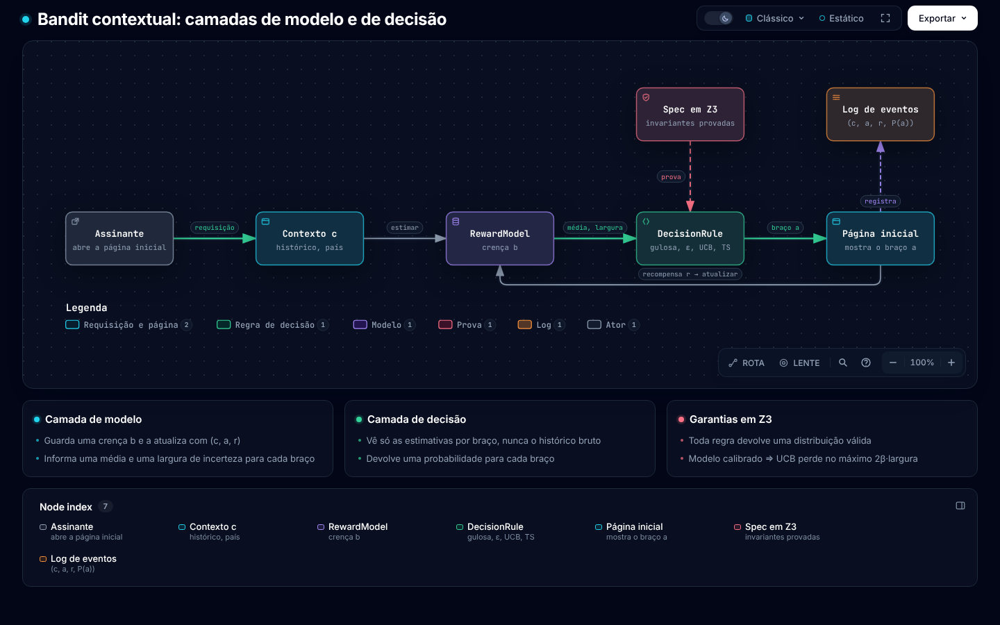
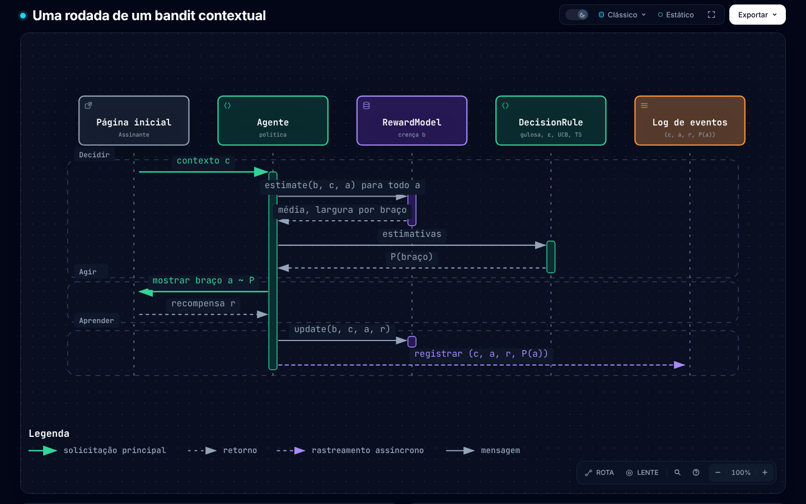
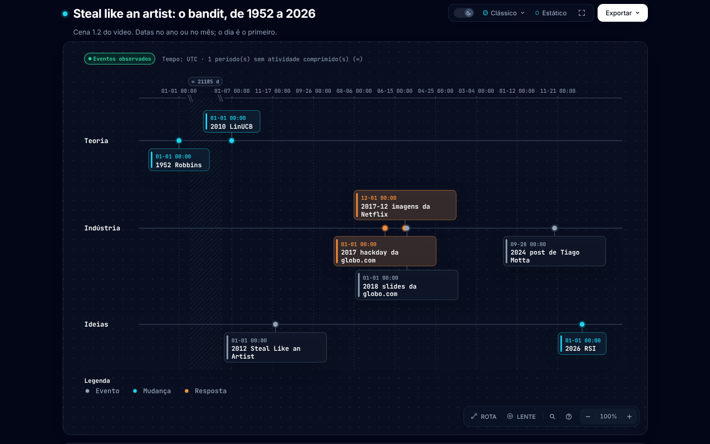
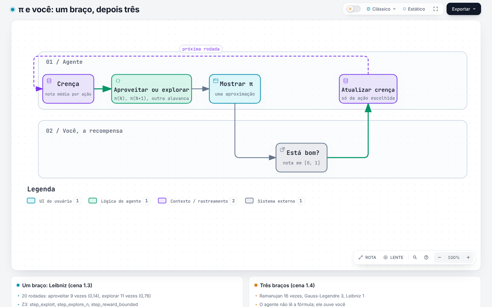
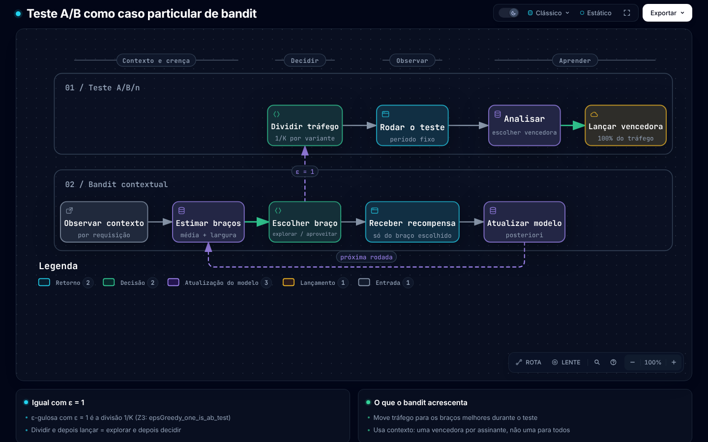
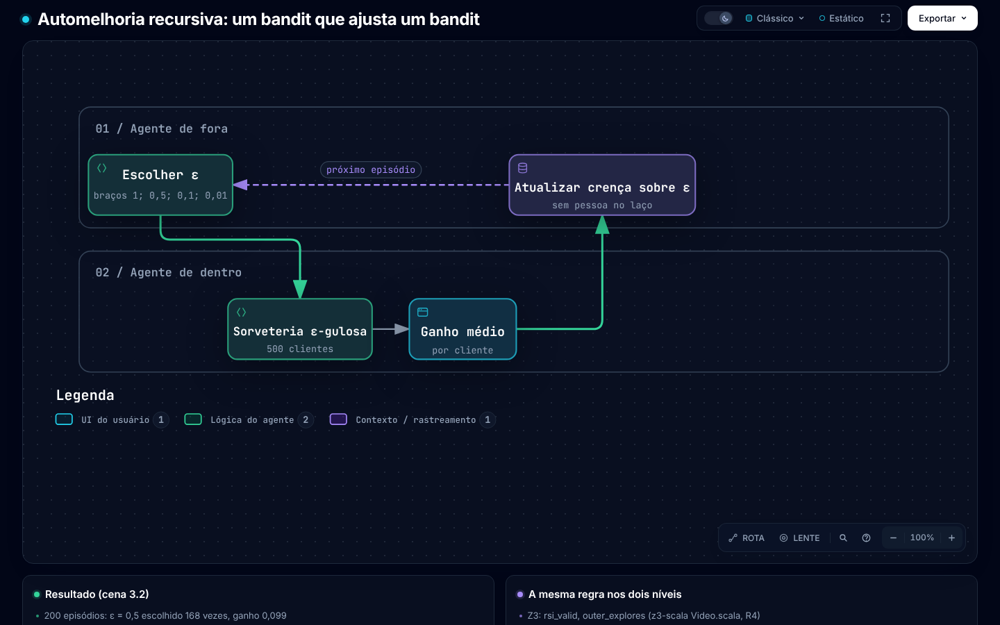

# Bandits contextuais

Tudo sobre o bandit contextual deste repositório está nesta página: a ideia, o índice de
arquivos, os comandos, a interface, o que o Z3 prova, o porte em Haskell e a nota do vídeo. O
código Z3 fica em [`z3-scala/`](../z3-scala/README.md). Padrão de escrita: gramatico, nível
`smart-note + descritivo`. Versão em inglês: [README.md](README.md).

## Sumário

1. [A ideia](#1-a-ideia)
2. [Arquivos](#2-arquivos)
3. [Como rodar](#3-como-rodar)
4. [A interface](#4-a-interface)
5. [O que o Z3 prova](#5-o-que-o-z3-prova)
6. [O porte em Haskell](#6-o-porte-em-haskell)
7. [Ressalvas](#7-ressalvas)
8. [Nota do vídeo](#8-nota-do-vídeo)
   - [Mapa de cenas](#mapa-de-cenas)
   - [Bloco 1. CMAB](#bloco-1-cmab)
   - [Bloco 2. Teste A/B](#bloco-2-teste-ab)
   - [Bloco 3. RSI](#bloco-3-rsi)
9. [Fontes](#9-fontes)

## 1. A ideia

O sistema escolhe uma opção (um **braço**) para cada requisição. O sistema conhece alguns dados da
requisição (o **contexto**). O sistema recebe a **recompensa** só do braço escolhido. A
**política** é a regra que leva do contexto ao braço. O **arrependimento** (*regret*) é a soma, em
todas as rodadas, da recompensa do melhor braço menos a recompensa do braço escolhido.

> **O bandit é uma regra de decisão sobre um modelo probabilístico.**
> O modelo transforma o histórico em crenças. A regra transforma as crenças numa ação.

```text
           contexto c
               │
               ▼
 histórico ─► RewardModel ──estimate(b, c, a) = (média, largura)──► DecisionRule ──► ação a
   ▲          (crença b)    sample(b, c, a)  ~ posteriori          gulosa / ε-gulosa /   │
   │                                                               UCB / Thompson        ▼
   └────────────── update(b, (c, a, r)) ◄────────────── recompensa r ◄──────────── ambiente
```

A regra de decisão vê só as estimativas de cada braço; a regra nunca vê o histórico nem o
contexto. Por isso, qualquer modelo que dê uma média e uma incerteza funciona com qualquer regra.
A afirmação `policy_factors` prova essa fronteira.

| Regra | Como a regra explora | Código |
|---|---|---|
| Gulosa | A regra não explora | `greedy` |
| ε-gulosa | A regra escolhe um braço aleatório com probabilidade ε | `epsGreedy ε` |
| UCB / LinUCB | A regra soma β vezes a largura à média | `ucb β` |
| Amostragem de Thompson | A regra sorteia uma média da posteriori e escolhe a maior | `thompsonArm` |

[](../docs/diagrams/pt-BR/bandit-architecture.html)

*Figura 1. A camada de modelo, a camada de decisão e a spec em Z3 (archify; clique para abrir o
diagrama interativo).*

## 2. Arquivos

| Parte | Arquivos |
|---|---|
| Especificação em Z3 | [`Bandit.scala`](../z3-scala/src/main/scala/bandit/domain/Bandit.scala) (as duas camadas, as regras), [`Theorems.scala`](../z3-scala/src/main/scala/bandit/domain/Theorems.scala) (K = 1 a 5), [`Examples.scala`](../z3-scala/src/main/scala/bandit/domain/Examples.scala) (modelo tabular, racionais exatos), [`Video.scala`](../z3-scala/src/main/scala/bandit/domain/Video.scala) (invariantes R1 a R5 do vídeo), [`BanditChecks.scala`](../z3-scala/src/main/scala/bandit/application/BanditChecks.scala); como o Z3 roda: [`z3-scala/README.md`](../z3-scala/README.md) |
| Por que Z3 e não Lean | [`docs/decisions/0001-z3-over-lean.md`](../docs/decisions/0001-z3-over-lean.md) |
| Porte em Haskell | [`haskell/src/ContextualBandit.hs`](../haskell/src/ContextualBandit.hs) (interface, regras, gerador SplitMix), [`Models.hs`](../haskell/src/Models.hs) (Beta-Bernoulli, linear bayesiano, `fromPredictor`), [`Video.hs`](../haskell/src/Video.hs), [`Pi.hs`](../haskell/src/Pi.hs), [`app/Main.hs`](../haskell/app/Main.hs) (verificação da spec e simulações), [`app/Video.hs`](../haskell/app/Video.hs) |
| LiquidHaskell | [`haskell/LIQUIDHASKELL.md`](../haskell/LIQUIDHASKELL.md) (o que está provado e o que é confiado), [`checks/liquidhaskell.sh`](../checks/liquidhaskell.sh) |
| Preprint | [`papers/contextual-bandits/`](../papers/contextual-bandits/metadata.md) |
| Roteiro do vídeo | [`script/`](script/README.md), os números em [`results.md`](script/results.md), os arquivos do Desmos em [`desmos/`](script/desmos/README.md) |
| Diagramas | [`docs/diagrams/src/build_candidates.py`](../docs/diagrams/src/build_candidates.py) (fonte, nos dois idiomas), [`docs/diagrams/pt-BR/`](../docs/diagrams/index.html) (HTML), `docs/diagrams/img/pt-BR/` (PNG) |
| Receitas e verificações | [`just/contextual-bandits.just`](../just/contextual-bandits.just), [`checks/contextual-bandits.sh`](../checks/contextual-bandits.sh), [`just/liquidhaskell.just`](../just/liquidhaskell.just) |

## 3. Como rodar

```bash
just z3                                  # toda afirmação em Z3 (nix develop .#scala); cada linha OK
cd haskell && cabal run examples         # verificação da spec e 4 simulações; ou: runghc -isrc app/Main.hs
cd haskell && cabal run video            # os experimentos do vídeo; escreve o results.md do roteiro
just liquid                              # LiquidHaskell; SAFE em cada módulo
just paper contextual-bandits            # o preprint (dentro de nix develop)
just script                              # o roteiro do vídeo
```

O primeiro bloco de `cabal run examples` compara o Haskell com `Examples.scala` e `Video.scala`.
Toda linha precisa dizer `OK`.

## 4. A interface

| Conceito | Z3 (`Bandit.scala`, `Examples.scala`, `Video.scala`) | Haskell |
|---|---|---|
| Braço | índice `0..K-1` de uma `List` do Scala | `Int` em `0..k-1` |
| Observação | `(contexto, braço, recompensa)` | `Obs c` |
| Saída do modelo | `(média, largura)`, dois reais do Z3 | `Estimate {mean, width}` |
| Modelo probabilístico | `update`, `estimate`, `posterior` (tabular) | `RewardModel c b {numArms, prior, update, estimate, sample}` |
| Regra de decisão | `List[Estimate] => List[Real]` | `[Estimate] -> [Double]` |
| Política | `policy(rule, history, context, arms)` | `policy m rule history ctx`, `act` |
| Alocação A/B/n | `epsGreedy(1, est)` = `uniform(K)` | `epsGreedy 1` |
| Teste A/B completo | `etc`, `etc_before`, `etc_after` | `etc` (`Video.hs`) |
| π como bandit | `step`, `leibnizPair_pos`, `ramTerm_pos` | `Pi.hs`, `singleArmed`, `multiArmed` |
| RSI | `outer`, `innerEps`, `rsi_valid` | `outer`, `inner`, `rsiLoop` |

## 5. O que o Z3 prova

O Z3 verifica cada afirmação por refutação (`unsat`), para K = 1 a 5 braços e todo valor real das
estimativas.

| Teorema | Afirmação |
|---|---|
| `greedy_valid`, `ucb_valid`, `epsGreedy_valid` | a saída é uma distribuição de probabilidade quando `0 ≤ ε ≤ 1` |
| `epsGreedy_prob` | o braço guloso recebe `1 - ε + ε/K`, cada outro braço recebe `ε/K` |
| `epsGreedy_explores` | cada braço tem probabilidade ≥ `ε/K` |
| `epsGreedy_one_is_ab_test` | a ε-gulosa com ε = 1 é a alocação uniforme de um teste A/B/n |
| `greedy_is_argmax`, `ucb_is_argmax` | o braço escolhido maximiza a pontuação |
| `ucb_zero` | a UCB com β = 0 é a gulosa |
| `ucb_gap` (lema do otimismo) | se o modelo é **calibrado** (`\|média − μ\| ≤ β·largura` em cada braço), o braço da UCB fica a até `2β·largura` do melhor braço |
| `greedy_gap` | se cada média fica a até δ da verdade, a gulosa perde no máximo 2δ |
| `policy_factors` | dois históricos com a mesma crença dão a mesma decisão |
| `step_exploit`, `step_explore_n`, `step_explore_reward`, `step_reward_bounded` | um braço: aproveitar não gasta termo; explorar gasta um e não baixa a recompensa, que fica em [0, 1] |
| `epsGreedy_zero`, `etc_before`, `etc_after`, `etc_valid` | o teste A/B (*explore then commit*) é uma regra só: uniforme antes da troca, gulosa depois, sempre válida |
| `rsi_valid`, `outer_explores` | o bandit de fora que escolhe o ε de dentro é a `epsGreedy` de novo, válida, e tenta cada ε |
| `leibnizPair_pos`, `ramTerm_pos`, `ramSum_lt_succ`, `ramApprox_anti` | cada par de Leibniz é positivo para todo real k ≥ 0; os termos de Ramanujan são positivos (k = 0..9), as somas crescem e a aproximação de π decresce |

O `ucb_gap` diz o que o modelo deve à camada de decisão: incerteza calibrada. Uma cota de
arrependimento do LinUCB precisa do `ucb_gap` em cada rodada (feito), da calibração com
probabilidade ≥ 1 − δ em todas as rodadas (uma cota de martingal, fora do que o Z3 decide) e de
Σ larguras = O(√(d T log T)) (o lema do potencial elíptico). Os dois últimos itens ficam abertos.

## 6. O porte em Haskell

O porte usa só `base` e `containers` e repete os nomes do Z3. O argmax fica com o primeiro máximo,
como no Z3. Para ligar um modelo, implemente quatro funções ou embrulhe o modelo com
`fromPredictor`:

```haskell
fromPredictor
  :: Int                                   -- number of arms
  -> s                                     -- model state (weights, handle, ...)
  -> (s -> Obs c -> s)                     -- online update; `const` if frozen
  -> (s -> c -> Arm -> (Double, Double))   -- predictive (mean, std)
  -> RewardModel c s
```

- **Forma fechada** (Beta-Bernoulli, gaussiano, regressão linear bayesiana): `update` é a
  atualização da posteriori, `estimate` dá a média e o desvio da posteriori (`betaBernoulli`,
  `bayesLinear` em `Models.hs`).
- **Treinado *offline*** (regressão logística, *gradient boosting*, um *ensemble*): congele o modelo
  com `const` e retreine em lotes fora do ciclo.
- **Qualquer regra**: `act m greedy`, `act m (epsGreedy 0.1)`, `act m (ucb 2)`, `thompsonArm m`.

A `width` precisa ser uma incerteza honesta. Um modelo confiante demais quebra a premissa
`calibrated`, e a UCB e a Thompson viram gulosas.

Saída de `cabal run examples` (arrependimento acumulado esperado, uma simulação pequena de cada,
não é *benchmark*):

```text
== 0. Spec check against Examples.scala and Video.scala ==   all OK
== 1. Beta-Bernoulli, 2 contexts x 3 arms, T=5000 (avg 20 runs)
greedy 41.1   eps-greedy 0.1 43.3   UCB beta=2 25.3   Thompson 32.8
== 2. Bayesian linear, d=3, 4 arms, T=2000 (avg 10 runs)
greedy 322.9  eps-greedy 0.1 62.0   LinUCB 25.3       LinTS 31.5
```

O LiquidHaskell verifica tipos refinados em `ContextualBandit.hs` e `Models.hs`: o `argmax` devolve
um índice válido, cada regra devolve probabilidades em [0, 1] e o Beta-Bernoulli mantém as
contagens em 1 ou mais. O [`LIQUIDHASKELL.md`](../haskell/LIQUIDHASKELL.md) lista o que a
verificação confia e o que fica de fora.

## 7. Ressalvas

- O Z3 prova sobre os reais e os racionais exatos. O Haskell usa `Double`, e as provas não cobrem o
  arredondamento de ponto flutuante. A verificação da spec mostra que os dois concordam no exemplo
  comum.
- O Z3 não tem indução: cada teorema vale para K = 1 a 5, não para todo K.
- A amostragem de Thompson é "a gulosa sobre uma amostra da posteriori". A aleatoriedade e o
  arrependimento dela não estão formalizados.
- O exemplo tabular usa largura `1/(n+1)`, um substituto racional de `1/√n`, para os exemplos
  ficarem exatos.

## 8. Nota do vídeo

O vídeo tem três blocos de 10 minutos: **CMAB**, **teste A/B** e **RSI**. Cada parágrafo tem o
número da cena do roteiro. Os números vêm de
[`results.md`](script/results.md), que `cabal run video` escreve. O
estilo final do vídeo é o do roteiro (Manim, fundo escuro, azul para a crença, amarelo para a
escolha, vermelho para o arrependimento); as figuras do archify dão a estrutura.

### Mapa de cenas

As figuras estão em `docs/diagrams/img/pt-BR/<nome>.png` e, interativas, em
[`docs/diagrams/pt-BR/<nome>.html`](../docs/diagrams/index.html). Os arquivos do Desmos estão em
[`script/desmos/`](script/desmos/README.md).

| Cena | Tempo | Figura | Desmos | Código |
|---|---|---|---|---|
| 1.1 Gancho | 0:00 | `bandit-round` | — | `beliefs` (`app/Video.hs`) |
| 1.2 Steal like an artist | 1:00 | `bandit-timeline` | — | `animation/timeline.py` (a fazer) |
| 1.3 π e você, um braço | 3:00 | `pi-arms` | `1-3-pi.txt` | `singleArmed`; `step` |
| 1.4 O nome | 5:00 | `pi-arms` | `1-3-pi.txt` | `multiArmed`; `Pi.hs` |
| 1.5 Modelo e regra | 6:30 | `bandit-architecture` | `1-5-width.txt` | `policy_factors` |
| 1.6 Explorar e aproveitar | 7:30 | — | `1-6-ucb.txt` | `greedy`, `epsGreedy`, `ucb`; `ucb_zero` |
| 1.7 A Netflix | 8:30 | `bandit-architecture` | — | `bayesLinear` |
| 2.1 O que é um teste A/B | 10:00 | `ab-test-vs-bandit` | `2-1-ab.txt` | `uniform`; `etc_before` |
| 2.2 O teste A/B é uma regra de bandit | 11:30 | `ab-test-vs-bandit` | `2-2-epsilon.txt` | `epsGreedy_one_is_ab_test`, `etc_after` |
| 2.3 O custo da espera | 13:00 | — | `2-3-regret.txt` | `abVsBandit` |
| 2.4 O contexto personaliza | 15:00 | `ab-test-vs-bandit` | — | `abVsBandit` |
| 2.5 O que o A/B faz melhor | 16:30 | `bandit-round` | `2-5-propensity.txt` | `policy` |
| 2.6 Resumo | 18:00 | `bandit-architecture` | — | `Theorems.scala` |
| 3.1 Três palavras | 20:00 | `rsi-loop` | — | `outer`, `innerEps` |
| 3.2 O menor ciclo recursivo | 21:30 | `rsi-loop` | — | `rsiLoop` |
| 3.3 O bandit na RSI de verdade | 24:00 | `rsi-loop` | — | `rsiLoop` |
| 3.4 Crença atual contra crença nova | 26:30 | `bandit-round` | `3-4-beta.txt` | `beliefs`; `betaBernoulli` |
| 3.5 O que não é bandit | 28:00 | `bandit-architecture` | — | `calibrated`, `ucb_gap` |
| 3.6 Fecho e créditos | 29:00 | — | — | `PROMPTS.md` |

### Bloco 1. CMAB

Tempo no vídeo: 0:00 a 10:00.

**1.1 Gancho.** O agente tem uma crença: a opção 0 agrada em 67 % das vezes, a opção 1 em 50 %.
Chegam 4 sinais positivos para a opção 1 e 2 negativos para a opção 0. A crença nova diz 0,57 e
0,62, e a escolha muda para a opção 1. O agente muda por evidência, não por palpite.

[](../docs/diagrams/pt-BR/bandit-round.html)

*Figura 2. Uma rodada: decidir, agir, aprender. Cenas 1.1, 2.5 e 3.4.*

**1.2 Linha do tempo.** O roteiro chama a cena de *steal like an artist*, a partir do livro de
Austin Kleon, de 2012.

| Ano | Marco |
|---|---|
| 1952 | Herbert Robbins formula o problema do bandit de múltiplos braços. |
| 2010 | Li, Chu, Langford e Schapire publicam o LinUCB; o contexto é um vetor [6]. |
| 2012 | Austin Kleon publica *Steal Like an Artist*. |
| 2017 | A globo.com cria um serviço de bandit num *hackday*, em Scala [9]. |
| 2017-12 | A Netflix publica "Artwork Personalization at Netflix" [1, 2]. |
| 2018 | Renan Moreira de Oliveira, da globo.com, mostra o slide "MAB ML PARA AB RL" [10]. |
| 2024 | Tiago Motta conta que o serviço da globo.com "ainda é usado" [9]. |
| 2026 | O bandit aparece no laço de automelhoria dos agentes (bloco 3). |

O roteiro conferiu as fontes de 1952, de 2012, da globo.com e de 2026
([`REFERENCES.md`](script/REFERENCES.md)). ⚠ Esta nota não abriu de
novo essas fontes. O amigo de 2018 não entra na figura: o roteiro ainda marca o nome e o mês como
`[a confirmar]`.

[](../docs/diagrams/pt-BR/bandit-timeline.html)

*Figura 3. A linha do tempo da cena 1.2. As datas têm precisão de ano ou de mês; o archify mostra
o dia 1.*

**1.3 π e você.** Você é a recompensa. Com um braço (a série de Leibniz), o agente mostra π(N) de
novo (aproveita) ou calcula mais um termo (explora). Você dá uma nota de 0 a 1 pela distância até
π. Em 20 rodadas, com ε = 0,2, o agente aproveitou 9 vezes (nota média 0,14), explorou 11 vezes
(nota média 0,76) e terminou em π(12). Com três braços, Gauss-Legendre dobra os dígitos a cada passo
(3, 8, 19, 41) e Ramanujan acerta 7 dígitos com 1 termo e 48 com 6. O agente puxou Ramanujan 16
vezes, Gauss-Legendre 3 e Leibniz 1. Os dois empatam com nota 1,00; a gulosa fica com o primeiro
máximo. O exemplo de π não tem contexto: é um MAB, e não um CMAB.

[](../docs/diagrams/pt-BR/pi-arms.html)

*Figura 4. O ciclo do π. Cenas 1.3 e 1.4.*

**1.4 O nome.** **B** de *bandit* (a caça-níquel é o *one-armed bandit*); **M** e **A** de
*multi-armed* (várias alavancas, cada uma com um prêmio médio desconhecido); **C** de contextual
(antes de puxar, o agente vê um dado da rodada, por exemplo manhã ou noite). Com contexto, a melhor
alavanca muda a cada rodada, e a política aprende uma função do contexto para a alavanca: linear no
LinUCB [6], uma tabela de duas linhas na sorveteria.

**1.5 e 1.6.** Ver [a ideia](#1-a-ideia): as duas camadas, o `policy_factors` e a tabela das
regras. O modelo do vídeo é tabular: média = soma / contagem, largura = `1/(n+1)`. Com β = 0, a UCB
é a gulosa (`ucb_zero`).

**1.7 A Netflix.** A Netflix escolhe a imagem de cada título para cada assinante, como descreve o
post do Netflix Tech Blog de 2017-12, de Chandrashekar, Amat, Basilico e Jebara [1, 2]. Numa
palestra de 2018, Jebara deu estes dados [3]: o contexto é o histórico de visualização e o país; o
braço é a imagem; a recompensa é uma reprodução; o sistema usa aprendizado *online* e bandits
contextuais; recebe cerca de 20 milhões de requisições de imagem por segundo no pico; a equipe usa
*replay* para avaliar uma política nova *offline*. Nessa escala o modelo precisa generalizar, como o
`bayesLinear` (média = contexto · pesos do braço). As fontes primárias são de 2017 e 2018. ⚠ Esta
nota não achou fonte primária sobre o uso em 2026: não afirme que a Netflix usa bandits hoje.

### Bloco 2. Teste A/B

Tempo no vídeo: 10:00 a 20:00.

**2.1 e 2.2.** Um teste A/B/n manda cada usuário para uma de `K` variantes por sorteio e depois
fica com a melhor (*explore-then-commit*). O teste é simples de montar, de ler e de defender. Em
termos de bandit:

1. O período de teste é a ε-gulosa com ε = 1 (`epsGreedy_one_is_ab_test`).
2. A fase de decisão é a ε-gulosa com ε = 0, a gulosa (`epsGreedy_zero`).
3. O teste completo é um ε que pula de 1 para 0 num dia marcado (R3: `etc_before`, `etc_after`).

A pergunta "A/B ou bandit?" vira outra: como ε deve cair ao longo do tempo?

[](../docs/diagrams/pt-BR/ab-test-vs-bandit.html)

*Figura 5. O teste A/B e o ciclo do bandit. Cenas 2.1, 2.2 e 2.4.*

**2.3 e 2.4. O custo da espera.** Uma sorveteria: três sabores, dois contextos (manhã e noite),
5.000 clientes, média de 20 sementes. O teste A/B usa metade dos clientes no sorteio.

| Política | Arrependimento |
|---|---|
| Teste A/B (T/2, depois decide) | 128,8 |
| Teste A/B sem contexto | 178,9 |
| ε-gulosa, ε = 0,1 | 76,4 |
| UCB, β = 2 | 19,5 |

O bandit manda mais tráfego para os braços que parecem melhores durante o teste. Jebara chama o
ciclo "coletar dados por meses, treinar, depois testar" de "a massive amount of regret" [3]. Um
teste A/B por segmento de usuários é um caso particular de bandit contextual.

**2.5 O que o A/B faz melhor.** A alocação aleatória fixa dá uma estimativa sem viés do efeito. O
bandit muda a alocação, e a média simples dos registros fica com viés. Registre a probabilidade de
cada escolha (a `policy` devolve a distribuição inteira) e use *replay* ou ponderação pelo inverso
da propensão (IPW). A Netflix usou um teste A/B para aprovar o sistema de imagens antes da
implantação [3]: o bandit substituiu o ciclo lento dentro do teste, não o teste.

**2.6 Resumo.** O teste A/B é uma política: sem contexto, alocação uniforme fixa, uma decisão no
fim. O bandit contextual relaxa as três escolhas. Em produção, segundo as fontes:

- ***Billboard* da Netflix**: uma palestra de 2018, de Jaya Kawale e Elliot Chow, descreve um
  *framework* de bandit com a ε-gulosa, *replay* *offline* e testes A/B *online*, porque os modelos
  em lote se adaptam devagar demais ao catálogo [4, 5].
- **globo.com**: o serviço escolhe "uma foto" e "a melhor posição para colocar publicidade" [9].

Regra prática: teste A/B para uma decisão única que precisa ser defendida; bandit para uma decisão
que se repete milhares de vezes por dia com erro barato; os dois juntos quando der.

### Bloco 3. RSI

Tempo no vídeo: 20:00 a 30:00.

**3.1 Três palavras.**

| Palavra | O que o agente faz | O que a palavra exige |
|---|---|---|
| *Improvement* | O agente escolhe melhor hoje do que ontem | Uma métrica |
| *Self-improvement* | O próprio agente faz a mudança | Um laço fechado, sem pessoa no meio |
| *Recursive self-improvement* | A mudança é no mecanismo que faz as mudanças | Acesso do laço ao próprio laço |

A Anthropic define RSI como um sistema que "could fully autonomously design and develop its
successor" [11].

**3.2 O menor ciclo recursivo.** O agente de dentro é a ε-gulosa da sorveteria. O agente de fora é
outro bandit, com valores de ε como braços. Em cada um de 200 episódios, o agente de fora escolhe
um ε, o de dentro atende 500 clientes, e o ganho médio é a recompensa de fora.

| ε de dentro | Episódios escolhidos (de 200) | Ganho médio por cliente |
|---|---|---|
| 1,0 | 11 | 0,080 |
| 0,5 | 168 | 0,099 |
| 0,1 | 12 | 0,085 |
| 0,01 | 9 | 0,057 |

A mesma `epsGreedy` funciona nos dois níveis (R4: `rsi_valid`, `outer_explores`). O ε = 0,5 ganha
porque o horizonte é curto e o modelo começa do zero.

[](../docs/diagrams/pt-BR/rsi-loop.html)

*Figura 6. O laço de fora escolhe o ε do laço de dentro. Cenas 3.1 a 3.3.*

**3.3 A RSI de verdade.** O artigo SIA (2026) descreve um "Feedback-Agent" que escolhe entre editar
o *scaffold*, os prompts e as ferramentas, ou atualizar os pesos, com um avaliador determinístico
como recompensa [12]: um bandit. ⚠ O roteiro leu o SIA por uma resenha, não pelo PDF. A Anthropic
relata uma aceleração de um código de treino de cerca de 3 vezes (maio de 2025) para cerca de 52
vezes (abril de 2026), e uma revisão automática de código que teria pegado cerca de um terço dos
erros por trás de incidentes passados [11].

**3.4 Crença atual contra crença nova.** O Beta-Bernoulli guarda duas contagens por opção, sucessos
e fracassos; cada sinal soma 1 numa das contagens. A crença nova soma os sinais novos aos antigos
(0,67 e 0,50 viram 0,57 e 0,62, cena 1.1), e a largura cai nos dois braços.

**3.5 O que não é bandit.** Quando a escolha de hoje muda o estado de amanhã, o problema é de
aprendizado por reforço completo. Uma recompensa fácil de enganar ensina o laço a enganar a
recompensa: o `ucb_gap` depende da premissa `calibrated`. ⚠ O roteiro não cita um trabalho
específico de *reward hacking*.

## 9. Fontes

1. Netflix Tech Blog, "Artwork Personalization at Netflix", 2017-12. <https://netflixtechblog.com/artwork-personalization-c589f074ad76> (esta nota leu um resumo do post, não o texto completo)
2. Dezeen, "Netflix targets different film artworks to suit users' viewing habits", 2017-12-20. <https://www.dezeen.com/2017/12/20/netflix-targets-film-artwork-depending-users-viewing-habits-design-technology/>
3. Tony Jebara, "Artwork Personalization at Netflix", palestra de abertura, 2018. <https://www.aicouncil.com/talks/artwork-personalization-at-netflix>
4. Jaya Kawale e Elliot Chow, "A Multi-Armed Bandit Framework for Recommendations at Netflix", 2018. <https://aicouncil.com/a-multi-armed-bandit-framework-for-recommendations-at-netflix>
5. Slides de [4]. <https://www.slideshare.net/slideshow/a-multiarmed-bandit-framework-for-recommendations-at-netflix/102629078>
6. Li, Chu, Langford e Schapire, "A Contextual-Bandit Approach to Personalized News Article Recommendation" (LinUCB), 2010. <https://arxiv.org/abs/1003.0146>
7. Lattimore e Szepesvári, *Bandit Algorithms*, Cambridge University Press, 2020.
8. O roteiro do vídeo e o registro das fontes dele: [`script/`](script/README.md), [`refs.bib`](script/refs.bib), [`REFERENCES.md`](script/REFERENCES.md).
9. Tiago Motta, post sobre o serviço de bandit da globo.com, 2024-09-28. Chave `motta2024bandit` em [8].
10. Renan Moreira de Oliveira, "Machine Learning na globo.com", slides, 2018. Chave `oliveira2018globo` em [8].
11. Anthropic, "When AI builds itself", 2026. Chave `anthropic2026builds` em [8].
12. Resenha do artigo SIA (arXiv 2605.27276), 2026. Chave `bhavsar2026sia` em [8]; status `partial`.
