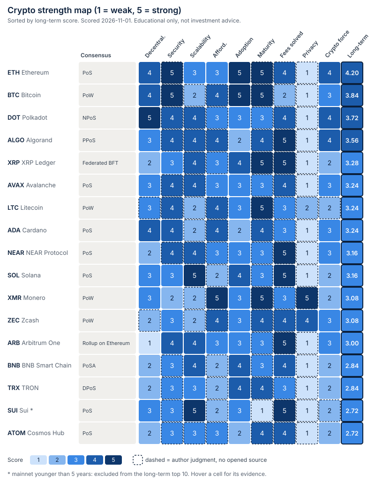

# Crypto strength map

A scored map of 17 crypto networks against nine factors, and a long-term
(5 to 10 year) top 10 derived from the scores. Scored on 2026-11-01.

> **Educational only, not investment advice.** The scores rate networks as
> technology. They say nothing about price. Many cells are the author's
> judgment, and the heatmap marks them.



The generated table is in [`results.md`](results.md). Every cell has its
evidence and source ids in [`data/scores.csv`](data/scores.csv).

## Build

```bash
just crypto-strength        # or: python3 crypto-strength/build.py
```

`build.py` uses the Python 3 standard library only. It checks the data (17
assets times 9 factors, scores from 1 to 5, evidence on every row, every source
id known, GitHub links well formed), then writes `heatmap.svg` and `results.md`.
To change a score, edit `data/scores.csv` and run it again.

## Data files

| File | What it holds |
| --- | --- |
| `data/assets.csv` | Name, kind (L1 or L2), consensus, mainnet year, CoinGecko market-cap rank, main GitHub repository |
| `data/scores.csv` | One row per asset and factor: score, one line of evidence, source ids |
| `data/sources.csv` | Every source opened for this survey, with what it supports and the date read |

Source id `J` means **author judgment**: general knowledge that no source opened
for this survey backs. These cells have a dashed border in the heatmap, and
`results.md` counts them per asset. 87 of the 153 cells are `J`. Treat them as
claims to check.

## Rubric

Every factor is scored from 1 (weak) to 5 (strong). Higher is always better, so
"fees solved" 5 means low and stable fees.

| Factor | Question | 5 | 3 | 1 | Main evidence |
| --- | --- | --- | --- | --- | --- |
| Decentralization | How many independent parties must collude to stop or rewrite the chain, and can ordinary users verify it? | Nakamoto coefficient above 50, or open block production and full validation on consumer hardware | Coefficient 10 to 30, or a few pools or staking providers hold large shares | One operator (for example a single sequencer) | Nakamoto coefficients from Chainspect (S02) and Nakaflow (S01); Bitcoin pool shares (S04); Lido share (S05) |
| Security | Has the chain kept safety and liveness in practice? | No halt or deep reorg in many years | Short halts or one serious bug | Repeated outages or successful attacks | Outage and incident reports (S09, S10, S14, S16, S17) |
| Scalability | How much does it process, and how fast is finality? | Over 1000 tx/s sustained or sub-second finality at high load | 10 to 200 tx/s, or capacity mainly through other layers | About 10 tx/s on L1 only | Chainspect live TPS and finality (S03) |
| Affordability | What does it cost an ordinary person to run a node or take part in block production? | CPU mining or no minimum stake, consumer hardware | Minimum stake in the tens of thousands of dollars, or large hardware | Data-centre hardware and a large stake, or a closed seat | Protocol rules and prices (S12) |
| Adoption | Is it used and built on? | Top 2 market cap and the most developers | Rank about 10 to 30, or many developers but low market cap | Below rank 40 and few developers | CoinGecko ranks (S12); Electric Capital developer counts (S11) |
| Maturity | How long has mainnet run? | 10 years or more | 5 to 6 years | Under 4 years | Mainnet year |
| Fees solved | Are fees low and stable under load, at L1 or through a native scaling path? | Sub-cent and stable | Low only because demand is low, or cheap only with staked resources | High and spiking | Fee design and L2 options |
| Privacy | Are amounts and parties hidden on chain? | Private by default | Strong but optional privacy | Transparent by default | Protocol design; shielded share (S13) |
| Crypto force | Can it resist the attacks that matter in 2026? | Concrete post-quantum plan in progress, attack cost high, no recent exploit of the base layer | Some defences, some open gaps | Small set of producers to coerce, recent base-layer attack, no post-quantum plan | Quantum readiness (S06, S07); 51% and selfish mining (S08, S09); stake concentration (S01, S02); bridge and upgrade risk (S15) |

**PoW vs PoS** is shown as a label column, not a score. Proof of work and proof
of stake are design choices with trade-offs that already show up in the other
columns: PoW buys security from energy and is hard to coerce, but a small PoW
chain can be rented (Monero, S08, S09). PoS is cheap to run and can finalise
fast, but stake tends to concentrate in a few providers (S05). Scoring the label
too would count those effects twice.

## Long-term score and top 10

The long-term score is a weighted mean of the nine factors. It favours what is
hard to change in 5 to 10 years: who controls the chain, whether it has held up,
whether it can survive new attacks, and how long it has run.

| Factor | Weight |
| --- | --- |
| Decentralization, security, crypto force, maturity | 2 each |
| Adoption | 1.5 |
| Scalability, fees solved | 1 each |
| Affordability, privacy | 0.5 each |

A project must have run mainnet for at least 5 years to be ranked ("mature").
This leaves out Sui (2023).

| # | Project | Long-term | Why it is here | Code |
| --- | --- | --- | --- | --- |
| 1 | Ethereum | 4.20 | Most developers, no halt since 2015, a funded post-quantum programme with a ~2029 target | [ethereum/go-ethereum](https://github.com/ethereum/go-ethereum) |
| 2 | Bitcoin | 3.84 | Longest record and highest attack cost; weak on fees, and BIP-360 has no activation path yet | [bitcoin/bitcoin](https://github.com/bitcoin/bitcoin) |
| 3 | Polkadot | 3.72 | Highest measured Nakamoto coefficient (179); low market adoption | [paritytech/polkadot-sdk](https://github.com/paritytech/polkadot-sdk) |
| 4 | Algorand | 3.56 | Already runs Falcon post-quantum signatures in state proofs; low adoption | [algorand/go-algorand](https://github.com/algorand/go-algorand) |
| 5 | XRP Ledger | 3.28 | Mature and cheap; trusted-list validation and a 64-minute halt in 2025 | [XRPLF/rippled](https://github.com/XRPLF/rippled) |
| 6 | Avalanche | 3.24 | Sub-second finality, Nakamoto coefficient 25 | [ava-labs/avalanchego](https://github.com/ava-labs/avalanchego) |
| 7 | Litecoin | 3.24 | 15 years of mainnet; weak on hashrate and quantum plans | [litecoin-project/litecoin](https://github.com/litecoin-project/litecoin) |
| 8 | Cardano | 3.24 | 2069 stake pools; survived a chain split in 2025 without a halt | [IntersectMBO/cardano-node](https://github.com/IntersectMBO/cardano-node) |
| 9 | NEAR | 3.16 | Sharded, very low fees; Nakamoto coefficient 9 | [near/nearcore](https://github.com/near/nearcore) |
| 10 | Solana | 3.16 | Highest throughput; no full outage since Feb 2024, but no post-quantum roadmap | [anza-xyz/agave](https://github.com/anza-xyz/agave) |

Ranks 6 to 8 tie at 3.24, and ranks 9 and 10 tie at 3.16. Ties go to the higher
plain mean. Just outside the top 10 are Monero and Zcash (3.08 each), Arbitrum
One (3.00), BNB Chain and TRON (2.84), and Cosmos Hub (2.72).

### How sensitive the ranking is

- With equal weights (the plain mean), Monero (3.33) and Zcash (3.22) enter the
  top 10 for their privacy. Cardano (3.00) drops out, and Avalanche, Litecoin,
  NEAR and Solana tie at 3.11 for the last three places. Ethereum stays first,
  and Bitcoin, Polkadot and Algorand tie second at 3.44.
- One point on one factor moves an asset by 0.15 (weight 2) or less, which is
  enough to reorder ranks 5 to 12. Only the top four are clearly separated.
- Solana's other main client, [firedancer-io/firedancer](https://github.com/firedancer-io/firedancer),
  and Zcash's node, [ZcashFoundation/zebra](https://github.com/ZcashFoundation/zebra),
  are also active. `zcash/zcash` (zcashd) is archived, so the data file links Zebra.

### GitHub links

Each link was checked on 2026-11-01 through the GitHub search API. All repositories
exist, are not archived, and had commits in the last two weeks. `anza-xyz/agave`
and `litecoin-project/litecoin` are forks on GitHub (of `solana-labs/solana`, now
archived, and of Bitcoin), so they appear only when the search includes forks.

## Limitations

- 87 of 153 cells are author judgment (source `J`). Opening a source for each of
  them is the main next step.
- The Nakamoto coefficient depends on who measures it. Solana is 17 on Chainspect
  and 6 on Nakaflow. It counts validators, not the entities behind them, so it
  flatters PoS chains whose stake sits with a few providers. Bitcoin and Ethereum
  have no figure on either site, so their decentralization score uses pool and
  Lido shares (S04, S05).
- The developer counts are Electric Capital's 2024 data, reported in 2025 (S11).
- Market caps and prices are one snapshot (S12) and move daily.
- Scores rate base layers. Exchange, bridge and application hacks lose users money
  without any base-layer failure, and no score here captures them.
- The heatmap shows evidence on hover only when the SVG is opened directly. On
  GitHub, read `data/scores.csv`.
