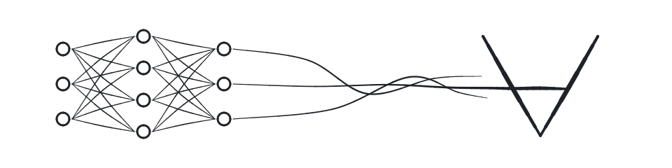

# The logo

The same drawing as [h0ffmann/awesome-neurosymbolic-ai](https://github.com/h0ffmann/awesome-neurosymbolic-ai)
(`assets/banner.svg`), by Matheus Hoffmann ([@h0ffmann](https://github.com/h0ffmann)), 2026.
[`logo.py`](logo.py) is that repository's `scripts/draw_banner.py`, with its outputs written next
to it; it writes the same bytes.

| File | Command | What it is |
|---|---|---|
| [`logo.svg`](logo.svg) | `python3 docs/logo/logo.py` | The README drawing |
| [`logo.desmos.json`](logo.desmos.json) | `python3 docs/logo/logo.py` | The same drawing as a Desmos graph state |

`python3 docs/logo/logo.py --check` verifies that the committed files are the output of the
script, and that every Desmos expression, read back from its LaTeX, stays within 0.01 of the line
it stands for.

**What it shows.** A 3-4-3 neural network, drawn as inked rings and synapses. Three strokes sweep
out of its last layer and braid across each other; the outer two taper and lift off the page, and
the middle one runs on to become the crossbar of ∀, the universal quantifier: the network writes
the symbol. Learning flows into a statement that holds *for all*, which is what a proof gives you.

**How it is drawn.** Each stroke is a list of hand-placed points with a brush width at each. A
Catmull-Rom spline runs through them; each piece is a cubic Bézier and each Bézier is one Desmos
parametric expression, `(a+bt+ct^{2}+dt^{3}, …)` for `0 ≤ t ≤ 1`, cut in four so the width changes
smoothly. The neuron rings are each four Béziers of constant width. Stdlib Python only.

**The look is [picasso](https://github.com/h0ffmann/picasso)'s**: one ink, `#1f2328` on light
pages and `#e6edf3` on dark ones (`prefers-color-scheme`), round ends, nothing else.

## Open the Desmos file

The file is a Desmos graph state (`version` 11). Desmos uses y up, so each y value is `240 - y` of
the SVG (the canvas is 960 × 240).

1. Open `https://www.desmos.com/calculator`.
2. Open the browser console.
3. Run `Calc.setState(<the content of logo.desmos.json>)`.

Not checked in Desmos itself; the check is local.

## Credits

- The pen and the method are [pirsig](https://github.com/h0ffmann/pirsig)'s
  (`crates/pirsig-drawings`), through [piabrota/nix-os](https://github.com/piabrota/nix-os)
  (`drawings/pen.nix`), ported to Python in awesome-neurosymbolic-ai.
- The previous logo (a turnstile ⊢ and a tombstone ∎) is in the git history of this folder.
