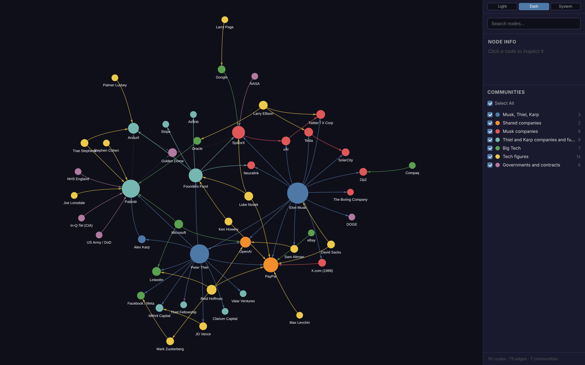

# Musk, Thiel and Karp graph

A graph of Elon Musk, Peter Thiel and Alex Karp: the companies they founded or
fund, the large deals around those companies, and their ties to other tech
figures. [graphify](https://graphify.com) draws it.



## Files

| File | What it holds |
| --- | --- |
| `nodes.csv` | One row per person, company, fund or agency: `id`, `label`, `group` (the colour), `kind`, `url` |
| `edges.csv` | One row per tie: `source`, `target`, `relation`, `year`, `status`, `url` (the source) |
| `build.py` | Checks the CSVs and writes `out/graph.json` in graphify's format (standard library only) |
| `render.mjs` | Opens `out/graph.html` in headless Chromium and writes `out/triad-graph.pdf` and PNG captures |
| `screenshots/` | The committed captures |

`out/` is not committed. Edit the CSVs, not `out/graph.json`.

## Sources

Every edge has a source URL. `status` is `confirmed` when the source states the
fact, and `reported` when only press reports support it (for example the
Golden Dome bid). graphify marks `reported` edges as `INFERRED`, and draws them
dashed. The figures and dates were checked against the linked pages on
2026-11-01. Wikipedia changes, so a later reader should check the page history.

graphify keeps one edge for each pair of nodes, so `build.py` joins two ties
between the same pair (for example NASA's two SpaceX contracts) into one edge.

## Build

```bash
pip install graphifyy==0.9.100   # the graphify CLI
just graph                        # out/graph.html, out/triad-graph.pdf, out/graph.png
just render-graph                 # serve out/graph.html at http://localhost:8000/graph.html
```

`render.mjs` needs Node and Playwright with Chromium. `graph.html` loads
vis-network 9.1.6 from unpkg.com. Where that host is blocked, give a local copy:

```bash
npm pack vis-network@9.1.6 && tar xzf vis-network-9.1.6.tgz
VIS_NETWORK=$PWD/package/standalone/umd/vis-network.min.js just graph
```

The PDF has the graph on page 1, and on the next pages each edge with its
relation, year and source.
