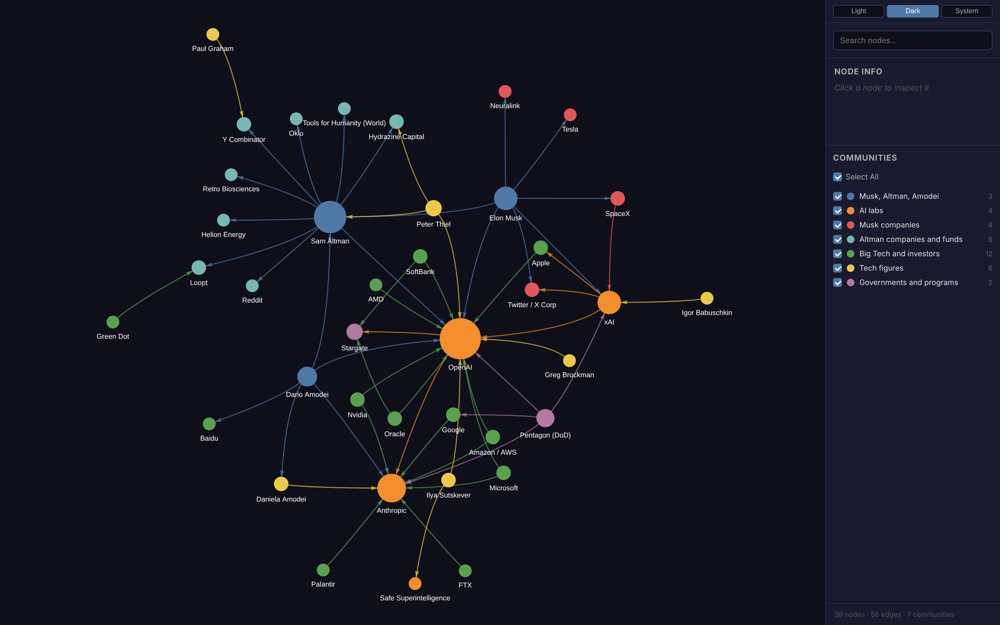
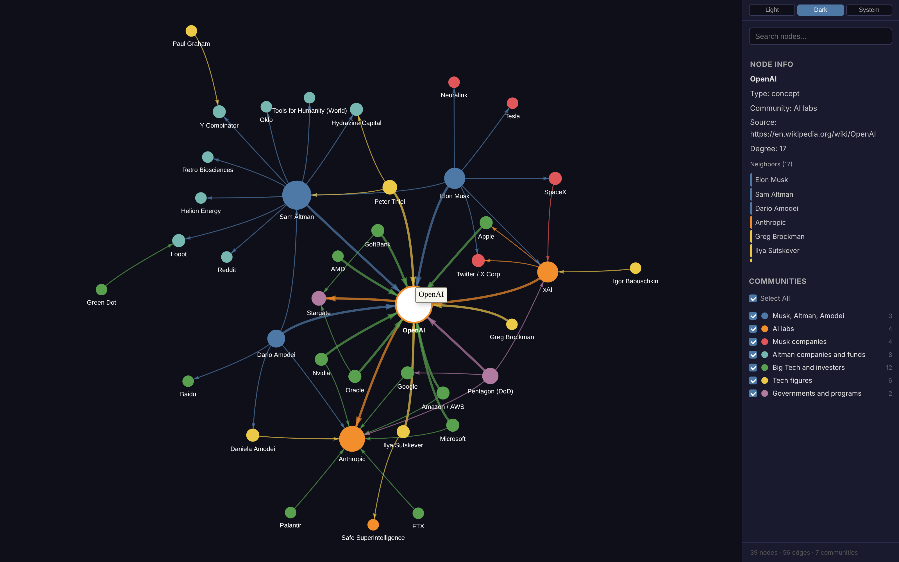

# Musk, Altman and Amodei

Elon Musk, Sam Altman and Dario Amodei: OpenAI, Anthropic, xAI and Safe
Superintelligence, their other companies and funds (SpaceX, Tesla, Loopt,
Y Combinator, Tools for Humanity, Helion, Oklo), the large deals around them
(Microsoft, Nvidia, AMD, Oracle, SoftBank, Amazon, Google, Stargate, the
Pentagon), and their ties to other tech figures. 39 nodes, 56 edges.

OpenAI selected. The side panel lists its neighbours:

## Colour groups

Musk, Altman and Amodei; AI labs; Musk companies; Altman companies and funds;
Big Tech and investors; tech figures; governments and programs.

## Notes

- All three meet at OpenAI. Musk and Altman co-founded it in 2015, and Amodei
  was its vice president of research from 2016. Anthropic was founded in 2021
  by seven former OpenAI employees, Amodei among them.
- Musk and Amodei have no direct edge. They meet through OpenAI and through the
  Pentagon, which gave xAI, Anthropic, OpenAI and Google $200M contracts each
  in July 2025.
- Peter Thiel and Palantir also appear in [Musk, Thiel and Karp](../musk-thiel-karp/README.md).
- Every edge here is `confirmed`. Several facts are from 2026 (the SpaceX and
  xAI merger, the Musk v. OpenAI verdict, the Pentagon's supply chain risk
  designation of Anthropic and the injunction against it, OpenAI's 2026
  round). They come from Wikipedia and the press as read on 2026-11-01.
- This graph includes Anthropic, the company that makes Claude, which built it.
  The edges keep to the same rule as the rest: one public source per fact.

Build and data format: [../README.md](../README.md).
