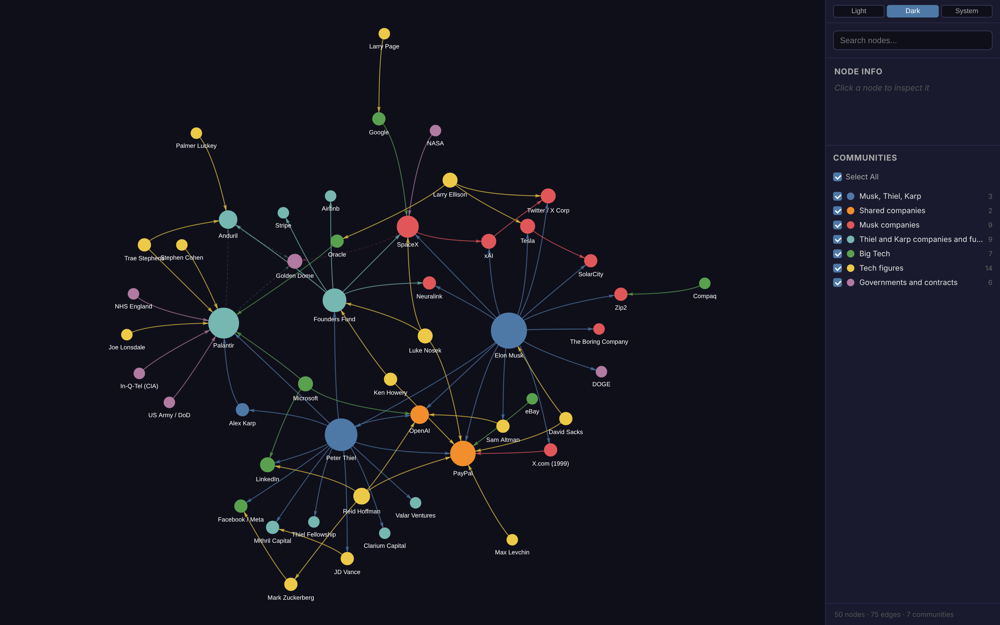
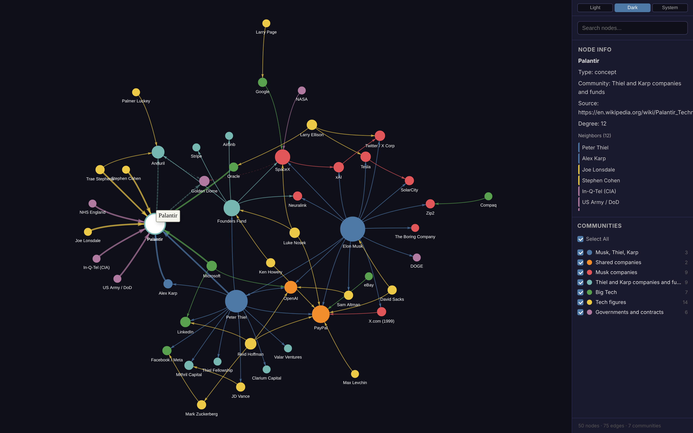

# Musk, Thiel and Karp

Elon Musk, Peter Thiel and Alex Karp: PayPal, Palantir, Founders Fund, SpaceX,
Tesla, xAI and the rest of their companies and funds, the large deals around
them (NASA, the US Army, NHS England, eBay, Golden Dome), and their ties to
other tech figures. 50 nodes, 75 edges.

Palantir selected. The side panel lists its neighbours:

## Colour groups

Musk, Thiel and Karp; shared companies (PayPal, OpenAI); Musk companies; Thiel
and Karp companies and funds; Big Tech; tech figures; governments and contracts.

## Notes

- Musk and Karp have no direct edge. They meet through Thiel, through the
  SpaceX-led Golden Dome bid with Palantir and Anduril, and through PayPal and
  OpenAI.
- The Golden Dome bid and the Palantir and Anduril defence consortium come
  only from press reports, so they are `reported` edges.

Build and data format: [../README.md](../README.md).
